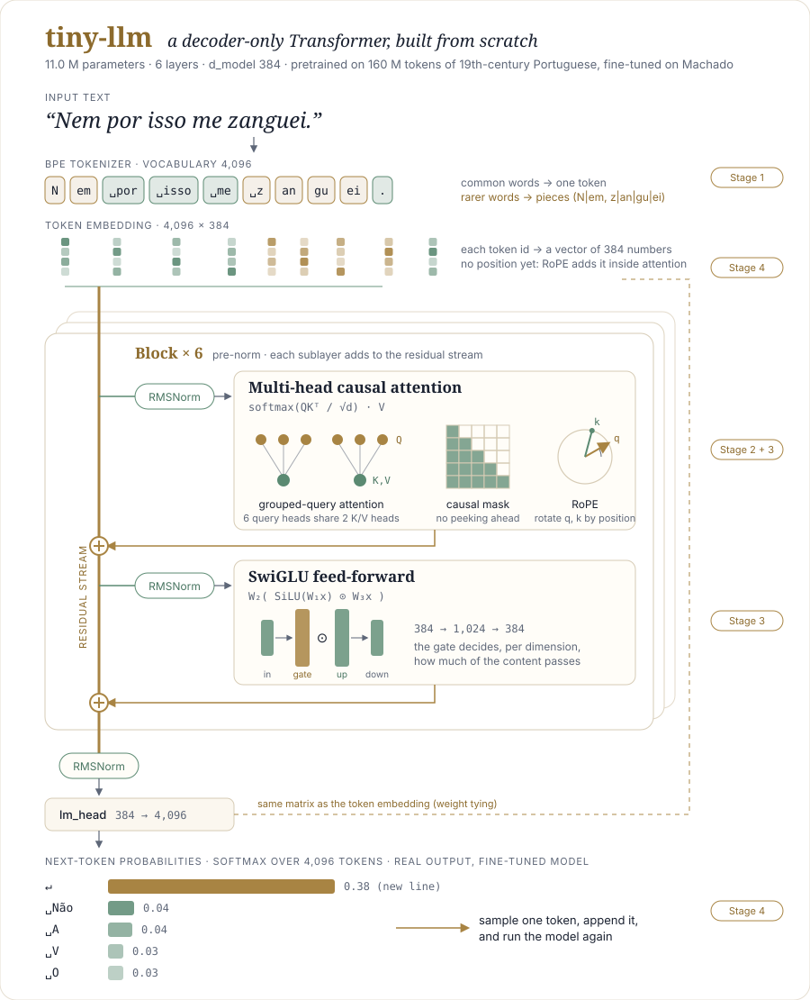
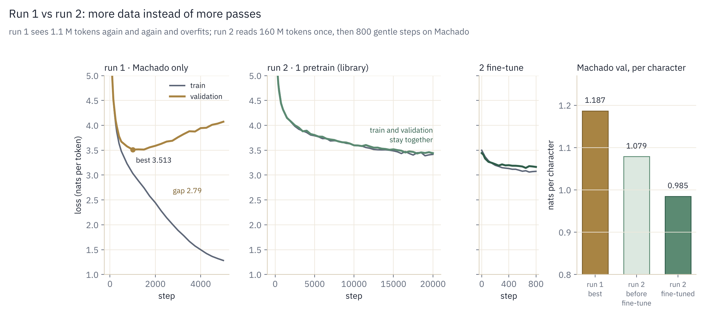

# tiny-llm: a GPT built from scratch, trained on a laptop

An 11-million-parameter decoder-only Transformer, written line by line in PyTorch and trained on
a MacBook. It was pretrained on 160 M tokens of public-domain 19th-century Portuguese, then
fine-tuned on the complete works of Machado de Assis. There is no Hugging Face model class
and no `nn.Transformer`: the tokenizer, attention, RoPE, grouped-query attention, SwiGLU, the
training loop and fine-tuning are all written here, each with its own tests.

I built it to understand *Attention Is All You Need* (2017) properly, along with what modern
models (Llama, Mistral, DeepSeek) have changed since. It comes with
[a library](docs/README.md) that explains every piece: the concept, the formulas, a worked
example, the code line by line, and the papers behind it.

<p align="center">
  
</p>

---

## Results

Two runs, same architecture, same laptop:

| | Run 1: Machado only | Run 2: pretrain on a library, fine-tune on Machado |
|---|---|---|
| Training data | 1.1 M tokens, seen ~37 times | 160 M tokens seen once, then 800 steps on Machado |
| Parameters | 10.2 M (vocabulary 2,048) | 11.0 M (vocabulary 4,096) |
| Time on an M-series Mac | 22 min | 82 min + 5 min |
| Overfitting | yes: validation got worse after step 1,000 | none in pretraining; slight at the end of fine-tuning |
| Loss per character on Machado's held-out text | 1.187 | 0.985 (−17 %) |

<p align="center">
  
</p>

Even before it saw a single line of Machado, the pretrained model predicted his text better than
run 1, which had trained on nothing else.

Capitú is the heroine of Machado's novel *Dom Casmurro* (1899). Here is the same prompt,
*"Capitú"*, with the same seed, before and after fine-tuning:

> pretrained: *Capitú. / Ai 1 / Ai ! / Thomaz (Piolho)…* (a play script: the name means nothing to it)
>
> fine-tuned: *Capitú achou um grande silencio, o mais baixo com a ponta de pedra. Sentou-se nos
> olhos com os olhos nella. Estacio inclinou-se novamente para ella. — Que é? perguntou ella sorrindo.*
>
> (Capitú found a great silence, the lowest, with the tip of stone. She sat on the eyes with her
> eyes on her. Estacio leaned toward her again. "What is it?" she asked, smiling.)

It is grammatical 19th-century Portuguese with Machado's dialogue and characters, but not coherent
beyond a sentence or two, which is about what to expect at 11 M parameters (GPT-2 small had 124 M). It is
also not a chatbot: it continues the text it is given. Answering questions would need another
training stage (instruction tuning), which this project does not do.

The full story, with every command, output and timing: [Stage 6: training runs](docs/06-training-runs.md)
and [Run 2: the log](docs/06b-run2-log.md).

---

## "Attention Is All You Need" (2017) vs. this model (Llama-style)

| Piece | 2017 Transformer | This project | Why it changed |
|---|---|---|---|
| Architecture | encoder + decoder | decoder only | next-token prediction is all a GPT needs |
| Core | scaled dot-product attention | the same, written by hand | still the heart of every LLM |
| Positions | sinusoidal, added to the input | RoPE, rotates q and k | encodes *relative* distance |
| Normalization | LayerNorm after each sublayer | RMSNorm before each sublayer (pre-norm) | more stable deep stacks, cheaper |
| Feed-forward | ReLU MLP | SwiGLU (gated) | better quality at equal cost |
| K/V heads | one per query head | grouped-query attention (6 query heads, 2 K/V) | 3× smaller KV cache |
| Output layer | separate matrix | tied to the embedding | fewer parameters, better small models |
| Optimizer | Adam + warmup | AdamW + warmup + cosine decay, gradient clipping | today's standard recipe |

---

## Try it

```bash
git clone <this repo> && cd tiny-llm
python3 -m venv .venv && source .venv/bin/activate
pip install -r requirements.txt     # PyTorch on a Mac includes the MPS (GPU) backend
pytest                              # 28 tests, one file per stage
```

The trained checkpoints (44 MB each) are not in the repository: train them with the commands
below. Then open [`notebooks/try_the_model.ipynb`](notebooks/try_the_model.ipynb), which runs both
run-2 models side by side: how a prompt is tokenized, samples with the same seed, next-token
probabilities and attention heatmaps. The notebook is saved with its outputs, so you can read it
on GitHub without running anything. From the terminal:

```bash
python sample.py --ckpt out/finetune/ckpt.pt --tokenizer data/pretrain/tokenizer.json --prompt "Capitú" --seed 42
```

Start a sentence the way Machado would, using his edition's spelling (*Capitú*, with the accent).
A different spelling is a different sequence of tokens: `C|ap|itu` leads to *Capítulo*.

## Reproduce the runs

Run 1: Machado only (22 min)
```bash
python prepare_data.py                       # Machado's 12 books from Project Gutenberg → data/corpus.txt
python prepare_tokens.py --vocab_size 2048   # train the BPE tokenizer, encode the corpus
python train.py --preset mac
```

Run 2: pretrain, then fine-tune (about 2 h in total)
```bash
python prepare_pretrain.py --source all      # 510 Gutenberg books + 1,250 cleanest Portuguese-PD docs, 23 min
python prepare_tokens.py --data_dir data/pretrain --vocab_size 4096
python prepare_tokens.py --data_dir data/machado --corpus data/corpus.txt --tokenizer data/pretrain/tokenizer.json
python train.py --preset mac-pretrain --max_iters 20000                    # one pass over 160 M tokens, 82 min
python train.py --preset mac-finetune --init_from out/pretrain/ckpt.pt     # 5 min
```

Prefix the long commands with `caffeinate -i` on a Mac so it does not sleep, and add
`| tee showcase/<name>.txt` to keep the output. On an NVIDIA GPU, `--preset pc` gives a
~25 M-parameter model with a 512-token context, bf16 and PyTorch's fused attention kernel.

---

## How it was built: the library

The project was written one stage at a time, each stage with its tests and a library page:

| Stage | What | Code | Library |
|---|---|---|---|
| 0 | The data: Machado's public-domain editions | `prepare_data.py` | [00](docs/00-data.md) |
| 1 | Byte-level BPE tokenizer, from scratch | `tokenizer.py` | [01](docs/01-tokenizer.md) |
| 2 | Scaled dot-product attention and the causal mask | `model.py` | [02](docs/02-attention.md) |
| 3 | RMSNorm, RoPE, grouped-query attention, SwiGLU | `model.py` | [03](docs/03-modern-upgrades.md) |
| 4 | Residual blocks, cross-entropy loss, sampling | `model.py` | [04](docs/04-assembling.md) |
| 5 | Batches, learning-rate schedule, AdamW, the training loop | `train.py` | [05](docs/05-training-loop.md) |
| 6 | Training runs, overfitting, pretraining and fine-tuning | `train.py`, `prepare_pretrain.py` | [06](docs/06-training-runs.md), [06b](docs/06b-run2-log.md) |

New to the topic? Start with [the big picture](docs/the-big-picture.md): what a model is, what
"training" changes, and one training step from start to finish. Every plot in the library is
computed from this repository's own code and data (`scripts/make_figures.py`).

<details>
<summary>Questions to check your understanding, one per stage</summary>

1. Why does a byte-level tokenizer never meet an "unknown word"? What did yours learn first?
2. Why divide by √d? What would go wrong without the causal mask during training?
3. RoPE makes a q·k score depend only on the distance between two tokens. Why is that useful for language?
4. A fresh model's loss is ≈ ln(vocabulary size). Why exactly that number?
5. Why warm up the learning rate, and why decay it?
6. Where did validation loss stop improving while training loss kept falling? What fixed it?

</details>

## Next: one modern upgrade at a time (Stage 7)

| | Upgrade | Used by | Result to show |
|---|---|---|---|
| 7.1 | KV cache in `generate` | every deployed LLM | tokens/s before vs after |
| 7.2 | QK-norm | Gemma 3, OLMo 2, Qwen 3 | stability at a higher learning rate |
| 7.3 | DeepSeekMoE: 1 shared + 8 routed experts, top-2 | DeepSeek-V2/V3/R1 | total vs active parameters, loss at equal compute |
| 7.4 | *(optional)* Multi-head latent attention | DeepSeek-V2/V3 | KV-cache bytes per token: MHA vs GQA vs MLA |
| 7.5 | *(bonus)* multi-token prediction | DeepSeek-V3 | loss curve |
| 7.6 | *(bonus)* Muon optimizer | Kimi K2, speed-run records | steps to a target loss |

Also planned: an ablation (RoPE → learned positions, SwiGLU → ReLU) to measure what the modern
pieces buy. Reading for 7.3–7.4: DeepSeek-AI (2024), *[DeepSeek-V2](https://arxiv.org/abs/2405.04434)*, §2.1–2.2.

---

## Data

Everything the model was trained on is public domain and can be redistributed:

- Machado de Assis: 12 books from [Project Gutenberg](https://www.gutenberg.org), in their original 19th-century spelling (*Pósthumas*, *pharmacia*).
- Pretraining library (Machado excluded): 510 Portuguese books from Project Gutenberg (17.1 M words), plus the 1,250 cleanest documents of [PleIAs/Portuguese-PD](https://huggingface.co/datasets/PleIAs/Portuguese-PD) (72.9 M words, scanned books selected with an OCR-quality score). `data/pretrain/manifest.csv` lists every document and its source.

## Files

| Path | What |
|---|---|
| `tokenizer.py` | byte-level BPE: train, encode, decode, save |
| `model.py` | attention, RMSNorm, RoPE, GQA, SwiGLU, blocks, `TinyGPT` |
| `train.py` | batches, learning-rate schedule, training loop, checkpoints, fine-tuning |
| `config.py` | model and training presets: `tiny`, `mac`, `mac-pretrain`, `mac-finetune`, `pc` |
| `prepare_data.py`, `prepare_pretrain.py`, `prepare_tokens.py` | build the corpora, train the tokenizer, encode |
| `sample.py`, `plot_loss.py` | generate text, plot a loss curve |
| `tests/` | one file per stage, 28 tests |
| `notebooks/try_the_model.ipynb` | both run-2 models side by side |
| `notebooks/figures.ipynb` | regenerates every figure of the library |
| `docs/` | the library, with figures in `docs/img/` |
| `scripts/` | figures, attention maps, dataset inspection |
| `showcase/` | real outputs: logs, loss data, samples during training |

## Acknowledgements

- Vaswani et al. (2017), *[Attention Is All You Need](https://arxiv.org/abs/1706.03762)*.
- Andrej Karpathy's *Let's build GPT* and [nanoGPT](https://github.com/karpathy/nanoGPT), which
  this project's training setup follows in several places.
- A class demo in the course IFT6758 (UdeM, Mila), building a GPT from scratch. This project
  started from it, and the library's illustrations take
  their idea from its figures.
- Project Gutenberg's volunteers and PleIAs, for the open text.

Built by Flavio Evangelista ([flavioev.com](https://flavioev.com)).

I wrote the model and training code myself; Claude (Anthropic) helped as a tutor, a reviewer, and with the documentation and supporting scripts.

## License

Code and docs: [MIT](LICENSE). The training text is public domain. The fonts in `scripts/fonts/`
(IBM Plex, Fraunces) keep their own SIL Open Font License.
