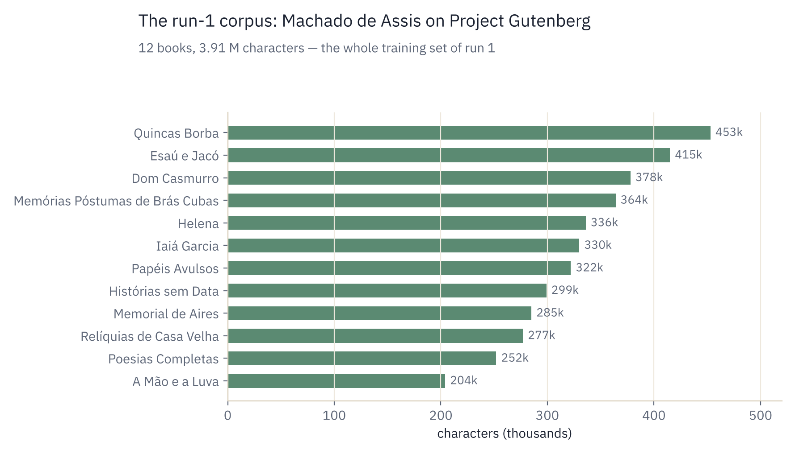
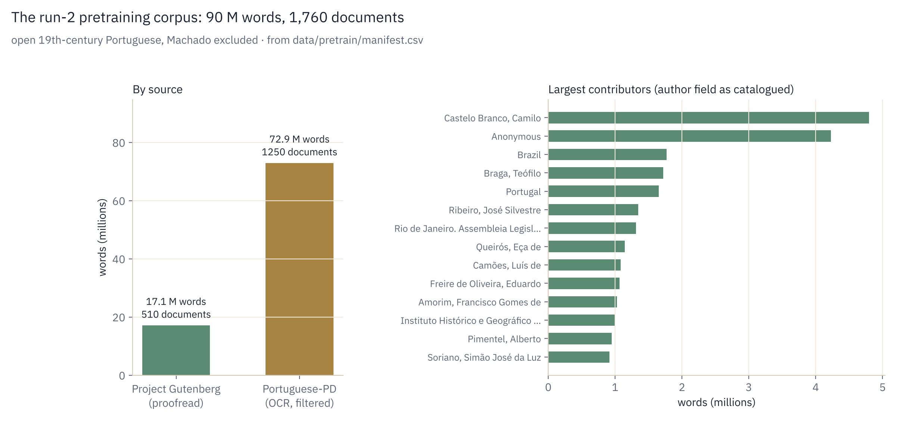

# Stage 0: The data

## Concept

A language model learns one thing: given some text, predict what comes next. Everything
it will ever "know" comes from the text it is trained on, so the corpus decides the
model's language, vocabulary, style and blind spots.

The project uses two corpora, both public domain:

- Machado de Assis (1839–1908), his complete works on Project Gutenberg: 12 books, 3.91
  million characters of 19th-century Brazilian Portuguese. Run 1 trains on it alone; run 2
  uses it for fine-tuning.
- A pretraining library for run 2: 1,760 documents and 90 million words of 19th-century
  Portuguese by other authors, from Project Gutenberg and the Portuguese-PD collection.
  Machado is deliberately left out of it.

The texts are the original editions, so the model learns the spelling of the time:
*pharmacia*, *elle*, *janella*, *Pósthumas*.

## Machado: what the corpus looks like

| | |
|---|---|
| Books | 12 (Dom Casmurro, Memórias Póstumas de Brás Cubas, Quincas Borba, Esaú e Jacó, Helena, …) |
| Characters | 3.91 M |
| Tokens, run 1 tokenizer (2,048) | 1.19 M train · 0.13 M validation · ≈ 2.96 characters per token |
| Tokens, run 2 tokenizer (4,096) | 1.13 M train · 0.13 M validation · ≈ 3.19 characters per token |

  

## In the code: `prepare_data.py`

The script does four things:

1. Find the books. It asks the free Gutendex API (`gutendex.com/books`) for every
   Portuguese-language book by the author, and keeps only books whose author name matches.
2. Download plain text. Each book is fetched from `gutenberg.org/ebooks/<id>.txt.utf-8`.
   If Gutendex is unreachable, a built-in list of Machado's Gutenberg IDs is used instead.
3. Clean it (`strip_gutenberg`):
   - keep only what lies between the `*** START OF …` and `*** END OF …` markers, dropping
     the license header and footer;
   - drop "Produced by…" credits and `[Ilustração]` image placeholders;
   - re-join hard-wrapped lines: Gutenberg breaks lines at ~70 characters, so lines inside
     a paragraph are glued back together and paragraphs are separated by a blank line;
   - remove `_underscores_`, which Gutenberg uses to mark italics.
4. Join the books with the special separator `<|endoftext|>` and write `data/corpus.txt`.

The separator matters: it tells the model where one document ends and another begins,
so it does not learn that the last line of *Helena* leads into the first line of *Yayá Garcia*.

## Why the split is per book

`prepare_tokens.py` keeps the first 90% of each book for training and the last 10%
of each for validation. Splitting the joined corpus at 90% would put only the last book in
validation, so the validation loss would measure "how well does the model know
*Relíquias de Casa Velha*" rather than "how well does it know Machado".

## The data-size question

A widely used rule of thumb from the Chinchilla paper is about 20 training tokens per
parameter. The `mac` model has ~10 M parameters, so it would ideally see ~200 M tokens;
the Machado corpus has 1.2 M. Expect overfitting: training loss keeps falling while
validation loss flattens and then rises. Stage 6 deals with it through early stopping
(the checkpoint with the best validation loss is kept), dropout and weight decay, and in
run 2 by pretraining on a larger Portuguese corpus and fine-tuning on Machado.

## Run 2: the pretraining library

Run 1 confirmed the problem above: the model overfits after about 1,000 steps. The fix is
more text that is close to Machado without being Machado, so `prepare_pretrain.py` builds a
library of his contemporaries from two open sources:

| Source | Available | Kept | Words kept |
|---|---|---|---|
| Project Gutenberg, all Portuguese texts (human-proofread) | 652 | 510 | 17.1 M |
| [PleIAs/Portuguese-PD](https://huggingface.co/datasets/PleIAs/Portuguese-PD) (scanned books and periodicals, before 1884) | 7,840 | 1,250 | 72.9 M |
| Total | | 1,760 | 90 M (545 MB of text) |

  

How it is built:

1. Gutenberg. The script downloads Gutenberg's catalogue file (`pg_catalog.csv`), lists every
   Portuguese text, skips Machado, and cleans each book with the same `strip_gutenberg` as above.
2. Portuguese-PD. These are OCR transcriptions of scanned books, so quality varies a lot. The
   script reads the documents in order and skips Machado, reference works (dictionaries, grammars,
   catalogues, almanacs) and text that is mostly symbols. Each remaining document gets a score: the share
   of its words (3+ letters) that appear in the Gutenberg vocabulary. Only documents scoring at
   least 0.88 are kept (the median is 0.82), very long periodicals are capped, and it stops when
   the whole corpus reaches 90 M words.
3. Every document kept is listed in `data/pretrain/manifest.csv` with its source, author,
   title, date and score, so the corpus can be audited and rebuilt.

A check for contamination found no Machado text in the library (a book titled *Helena* turned
out to be Almeida Garrett's). Tokenized with the run-2 tokenizer, the library is 178 M tokens
(160 M train, 18 M validation, ≈ 3.06 characters per token): about 15 tokens per parameter,
close to the Chinchilla rule of thumb.

The OCR part still contains some scanning artefacts: 15,000 to 20,000 "Digitized by Google"
lines and about 7,500 runs of `-----` or `......` from tables of contents. Together they are
under 0.1 % of the text, too little to matter for training, but they will be removed before the
corpus is published. Details and timings: [Stage 6](06-training-runs.md) and
[Run 2: the log](06b-run2-log.md).

## Licensing

All the text is in the public domain: Machado's works, the Gutenberg books, and
Portuguese-PD, which PleIAs released as cleared for training and redistribution. The repo
ships the download scripts, not the text (`data/` is in `.gitignore`). Generated samples,
loss curves and trained weights are not Gutenberg files and can be shared freely.

## References

- Project Gutenberg: <https://www.gutenberg.org>
- Gutendex API: <https://gutendex.com>, source at <https://github.com/garethbjohnson/gutendex>
- PleIAs, *Portuguese-PD*: <https://huggingface.co/datasets/PleIAs/Portuguese-PD>
- Hoffmann et al. (2022), *Training Compute-Optimal Large Language Models* ("Chinchilla"): <https://arxiv.org/abs/2203.15556>
