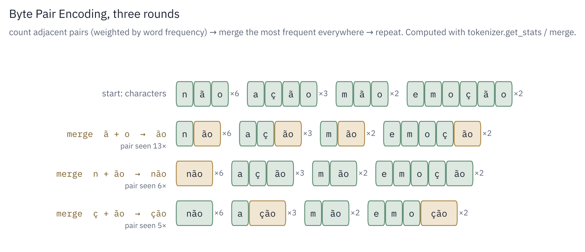
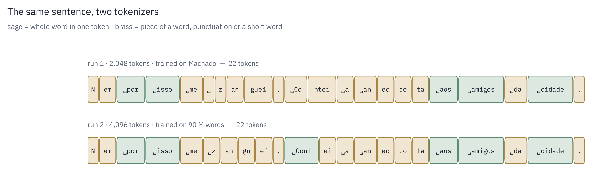

# Stage 1. Tokenization: byte-level BPE

## Concept

A neural network works on numbers, not text. A tokenizer turns text into a sequence
of integers (token ids) and back. There are three obvious choices of unit:

| Unit | Vocabulary | Problem |
|---|---|---|
| Characters | ~100 | sequences are very long; the model must spend capacity learning to spell |
| Words | 100,000+ | huge vocabulary, and any word not seen in training is *unknown* |
| Subwords (BPE) | chosen, here 2,048 | none serious: the compromise used by GPT, Llama and Claude |

**Byte Pair Encoding** (BPE) starts from the smallest possible units and repeatedly glues the
most frequent adjacent pair into a new unit. Frequent words end up as single tokens;
rare words stay split into pieces.

Byte-level means the starting units are the 256 possible byte values, not characters.
Any text in any language is a sequence of UTF-8 bytes, so nothing is ever "unknown": a
word the tokenizer has never seen just falls back to smaller pieces, down to single bytes.
The worst case is more tokens, never an error.

## The algorithm

Training (learning the merges):

```
vocabulary ← the 256 byte values
repeat (vocab_size − 257) times:
    count every adjacent pair of tokens in the corpus
    pick the most frequent pair (a, b)
    create a new token  t = a + b
    replace every occurrence of (a, b) by t
```

Encoding (using the merges on new text): start from bytes and replay the learned merges
in the order they were learned, because later merges are built from earlier ones.

Decoding: look up the bytes behind each token, concatenate, decode as UTF-8.

## Formulas

Let the corpus be a multiset of words $w$ with frequencies $f(w)$, each word a sequence of
token ids $`w = (t_1, \dots, t_n)`$. The count of a pair $(a, b)$ is

```math
\text{count}(a, b) \;=\; \sum_{w} f(w) \cdot \big|\{\, i : t_i = a,\; t_{i+1} = b \,\}\big|
```

and each training step chooses

```math
(a^*, b^*) \;=\; \arg\max_{(a,b)} \; \text{count}(a, b)
```

## Pre-tokenization

Before BPE, a regular expression cuts the text into chunks so merges never cross word
boundaries:

```
"Uma noite destas, vindo da cidade"
→  "Uma" | " noite" | " destas" | "," | " vindo" | " da" | " cidade"
```

(These are the first words of *Dom Casmurro*: "One of these nights, coming back from town".)

The leading space stays attached to the word, as in GPT-2, so `" da"` and `"da"` are
different tokens. The pattern uses `\p{L}` ("any Unicode letter"), so `ç`, `ã` and `é`
count as letters.

## Worked example

Corpus (letters instead of byte ids for readability):

```
não × 6    ação × 3    mão × 2    emoção × 2
```

| Round | Pair counts (top) | Winner | Words after the merge |
|---|---|---|---|
| 1 | ã+o: 13 · n+ã: 6 · ç+ã: 5 | ão | n·ão ×6, a·ç·ão ×3, m·ão ×2, e·m·o·ç·ão ×2 |
| 2 | n+ão: 6 · ç+ão: 5 | não | não ×6, a·ç·ão ×3, m·ão ×2, e·m·o·ç·ão ×2 |
| 3 | ç+ão: 5 · a+ç: 3 | ção | não ×6, a·ção ×3, m·ão ×2, e·m·o·ção ×2 |

Frequencies never change; only the shape of each word does. Each merge creates new pairs
(`n+ão`, `ç+ão`) that did not exist before, which is why pair counts are recomputed every
round. In real UTF-8, `ã` and `ç` are 2 bytes each, so the tokenizer first spends a merge
gluing those bytes into a character.

<p align="center">
  
</p>

*The same three rounds, computed by running the project's own get_stats and merge on the toy corpus.*

## In the code: `tokenizer.py`

### `get_stats`: count the pairs

```python
stats = Counter()
for word, freq in words.items():
    for a, b in zip(word, word[1:]):
        stats[(a, b)] += freq
return stats
```

`words` maps each distinct chunk (a tuple of ids) to how often it occurs. `zip(word, word[1:])`
yields the adjacent pairs. Adding `freq` instead of 1 gives the same counts as scanning the
full text, while processing each distinct chunk only once. This is what makes a pure-Python
BPE fast enough on 4 M characters.

### `merge`: replace a pair everywhere in one word

```python
result = []
i = 0
while i < len(ids):
    if i < len(ids) - 1 and (ids[i], ids[i + 1]) == pair:
        result.append(new_id)
        i += 2
    else:
        result.append(ids[i])
        i += 1
return tuple(result)
```

It scans left to right; on a match it emits the new id and skips two positions, so
merges never overlap: `merge((1, 1, 1), (1, 1), 7)` gives `(7, 1)`, not `(7, 7)`. It returns a
tuple because the result is used as a dictionary key, and Python keys must be immutable.

### `train`: the loop

```python
for i in range(n_merges):
    new_id = 256 + i
    stats = get_stats(words)
    if not stats:
        break
    pair = max(stats, key=stats.get)
    words = {merge(word, pair, new_id): freq for word, freq in words.items()}
    self.merges[pair] = new_id
    self.vocab[new_id] = self.vocab[pair[0]] + self.vocab[pair[1]]
```

- `n_merges = vocab_size − 256 − 1`: 256 slots are the bytes, one is reserved for `<|endoftext|>`.
- `break` stops early if every chunk has become a single token (nothing left to count).
- The dictionary comprehension rewrites every word with the new merge, keeping its frequency.
- `self.merges` records the merge rules in creation order; `self.vocab` records the bytes each
  id stands for, so decoding is a simple lookup.

### `_encode_chunk`: replay the merges on new text

```python
ids = list(chunk)
while len(ids) >= 2:
    pairs = [(ids[i], ids[i + 1]) for i in range(len(ids) - 1)]
    best_pair = min(pairs, key=lambda p: self.merges.get(p, float("inf")))
    if best_pair not in self.merges:
        break
    new_id = self.merges[best_pair]
    ids = list(merge(ids, best_pair, new_id))
return ids
```

It picks the pair with the lowest merge id, not the most frequent one. Merge ids record
the order of learning, and later merges are built from earlier ones (`não` = `n` + `ão`), so
replaying them in order cuts new text exactly as training would have. Pairs that were never
learned get id ∞ and are never chosen; when the best pair is ∞, nothing more can merge.

`encode` adds two things around it: it splits on `<|endoftext|>` to insert the special id, and
it caches each chunk's encoding, because common chunks such as `" que"` appear tens of
thousands of times.

## What the tokenizer learned from Machado

From `python prepare_tokens.py` (vocabulary 2,048, trained in 46 s):

| Merge | Token | Note |
|---|---|---|
| 1 | `' d'` | the most frequent pair in the corpus: *de, da, do, disse, depois* |
| 101 | `' uma'` | whole common words appear early |
| 401 | `' porque'` | |
| 1201 | `' janella'` | 19th-century spelling, double L |
| 1401 | `' Quincas'` | a character name, frequent in one novel |
| 1791 | `' achava'` | the last merge |

A sentence as the model sees it:

```
 Nem| por| isso| me| |z|an|guei|.| Co|ntei| a| an|ec|do|ta| aos| amigos| da| cidade|,
```

Common words stay whole; rare ones (*anecdota*, *zanguei*) are split into pieces. The result
is about 3 characters per token, so the 256-token context window covers roughly 750
characters, about two paragraphs.

## Run 2: a second tokenizer

Run 1's tokenizer (2,048 tokens) was trained on Machado only. For run 2 a new one is trained
on the 90 M-word pretraining corpus with 4,096 tokens: a larger vocabulary suits a larger,
more varied corpus (Brazilian and Portuguese authors, poetry, plays, periodicals), and each
token then covers more text, so the 256-token context sees more of it. The same file is then
reused to encode Machado (`--tokenizer`), because a model can only be fine-tuned on token ids
from the vocabulary it was pretrained with. See [Stage 6](06-training-runs.md).

What it learned, from `showcase/tokenizer_pretrain.txt` (trained in 444 s on a 10 M-character
sample drawn from the whole library):

| Merge | Token | Note |
|---|---|---|
| 1 | `' d'` | the same first merge as run 1 |
| 401 | `' muito'` | |
| 1401 | `'.^'` | an artefact of the scanned books (OCR) |
| 2001 | `'25'` | numbers: the library has periodicals, laws and dates |
| 3601 | `'CAPITULO'` | chapter headings, frequent across many books |
| 3839 | `'zil'` | the last merge (as in *Brazil*) |

The merges reflect the wider library: numbers, chapter headings and a few OCR traces are
among them.

### Spelling matters

The model sees ids, not letters, so two spellings of a word are two different inputs. The
Machado edition spells his heroine *Capitú*, with the accent (346 times). The run-2 tokenizer
cuts the two spellings differently:

```
Capitú  ->  C | ap | it | ú
Capitu  ->  C | ap | itu
```

`itu` is how *Capítulo* starts, so a prompt written "Capitu" sends the model toward chapter
headings and *capital*, and only "Capitú" reaches the character. Run 2's training snapshots
used "Capitu" and never found her; with the edition's spelling, the fine-tuned model writes
about her immediately ([Run 2: the log](06b-run2-log.md), step 5).

<p align="center">
  
</p>

## How it is tested: `tests/test_stage1_tokenizer.py`

| Test | What it proves |
|---|---|
| `test_1_1_get_stats` | pair counts are weighted by word frequency |
| `test_1_2_merge` | left-to-right, non-overlapping replacement, including edge cases |
| `test_1_3_train…` | training reaches the target vocabulary and learns `ção`, which requires stacking several merges |
| `test_1_4_roundtrip…` | `decode(encode(text)) == text`, including emoji and Japanese never seen in training, and BPE compresses the text |
| `test_special_token_and_save_load` | `<\|endoftext\|>` maps to one id; a saved and reloaded tokenizer encodes identically |

## 2017 vs. today

The 2017 Transformer used BPE (shared source/target vocabulary of ~37,000 tokens) on
*characters*. GPT-2 (2019) moved BPE to *bytes*, removing unknown tokens entirely, and added
the regex pre-tokenization used here. Modern LLMs keep the same design with much larger
vocabularies (Llama 3: ~128,000 tokens). A tokenizer trained on English is wasteful on
Portuguese: words like *coração* split into many pieces. That is one reason to train your own
tokenizer on your own corpus.

## References

- Sennrich, Haddow, Birch (2016), *Neural Machine Translation of Rare Words with Subword Units*: <https://arxiv.org/abs/1508.07909>
- Radford et al. (2019), *Language Models are Unsupervised Multitask Learners* (GPT-2, byte-level BPE): <https://cdn.openai.com/better-language-models/language_models_are_unsupervised_multitask_learners.pdf>
- Gage (1994), *A New Algorithm for Data Compression*, the original BPE, as a compression method
