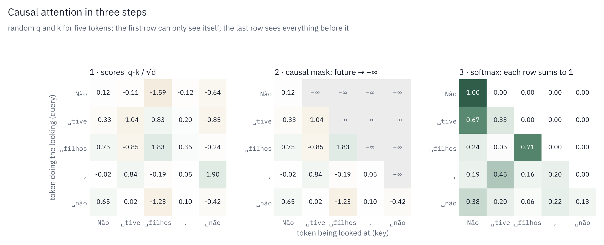
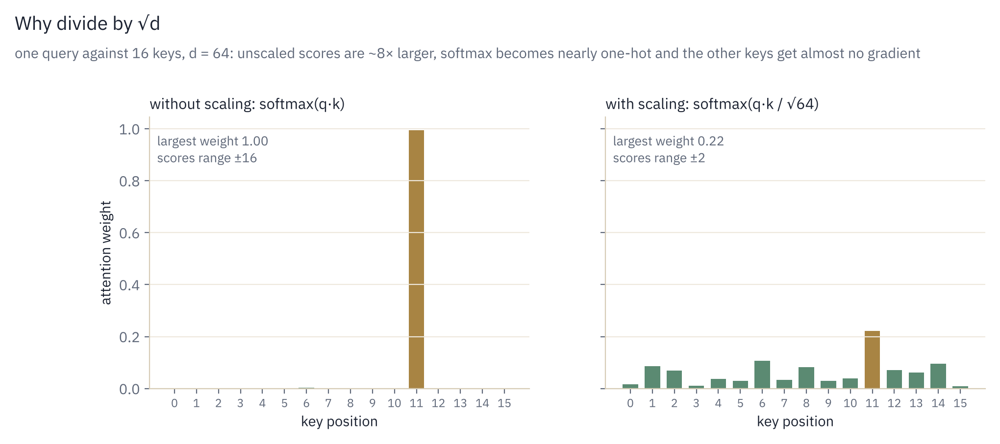
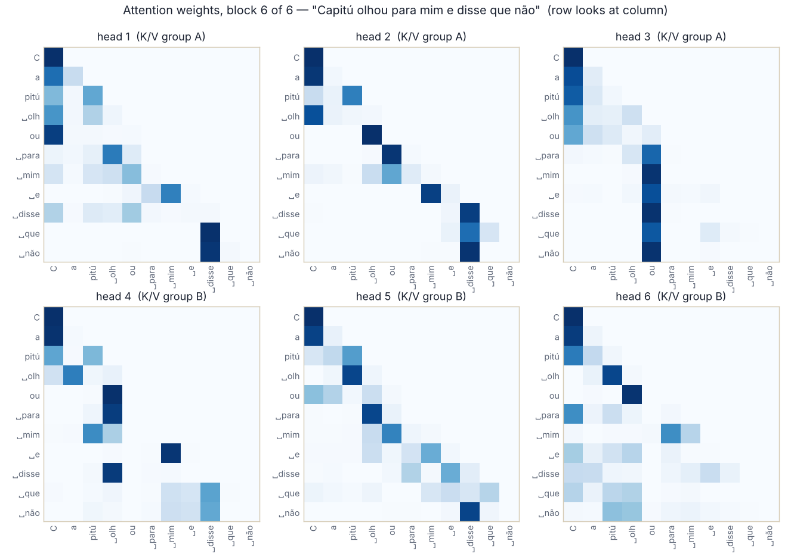
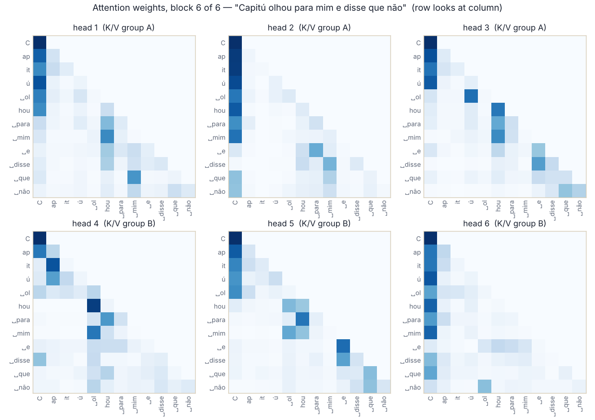

# Stage 2: Scaled dot-product attention

## Concept

To predict the next word, a token needs information from the tokens before it. In
*"Capitú olhou para mim e ___"* ("Capitú looked at me and ___"), the blank depends on *Capitú*
and *olhou* (looked), not just on *e* (and). Capitú is the heroine of Machado's *Dom Casmurro*;
the Portuguese used in the examples is translated in [the index](README.md#the-portuguese-in-the-examples).

**Attention** is how a token gathers that information. Every token produces three vectors:

| Vector | Name | Role |
|---|---|---|
| **q** | query | "what am I looking for?" |
| **k** | key | "what do I contain?", a label others can match against |
| **v** | value | "what do I pass on if someone attends to me?" |

Each token compares its query with every key. The better the match, the more of that
token's value it takes. The output is a weighted average of values, with weights
decided by query–key similarity. It works like a soft, learned dictionary lookup in which
every entry contributes in proportion to how well it matches.

## Formulas

From *Attention Is All You Need*, equation (1):

```math
\text{Attention}(Q, K, V) \;=\; \text{softmax}\!\left( \frac{Q K^\top}{\sqrt{d}} \right) V
```

For a single query $`q_i`$ (token $i$), with $T$ keys and values:

```math
s_{ij} = \frac{q_i \cdot k_j}{\sqrt{d}}
\qquad
a_{ij} = \frac{e^{s_{ij}}}{\sum_{j'} e^{s_{ij'}}}
\qquad
o_i = \sum_{j} a_{ij} \, v_j
```

- $`s_{ij}`$: the score, how well token $i$'s question matches token $j$'s label
- $`a_{ij}`$: the attention weight; each row sums to 1 (softmax)
- $`o_i`$: the output for token $i$, the weighted average of all values

### The causal mask

A language model must not see the future during training, otherwise predicting the next
token is trivial: it would just read it. So for $j > i$ the score is set to $`-\infty`$ before
the softmax:

```math
s_{ij} = -\infty \;\;\text{for}\;\; j > i
\quad\Longrightarrow\quad
a_{ij} = \frac{e^{-\infty}}{\dots} = 0
```

Token $i$ can only attend to tokens $`1 \dots i`$.

<p align="center">
  
</p>

### Why divide by $`\sqrt{d}`$

If the components of $q$ and $k$ are independent with mean 0 and variance 1, then
$`q \cdot k = \sum_{m=1}^{d} q_m k_m`$ is a sum of $d$ such products, so its variance is $d$.
With $d = 64$, scores typically range over ±8 or more.

Softmax of large numbers is nearly one-hot: almost all the weight goes to the largest score.
Its gradient with respect to the other scores is then nearly zero, so the model stops learning
which other tokens matter. Dividing by $`\sqrt{d}`$ brings the variance back to 1, keeping the
softmax in a range where gradients flow.

<p align="center">
  
</p>

## Worked example

Three tokens, with each value shown as a single number for readability.

```
           Não    tive   filhos
scores  [  s₁₁    -∞     -∞   ]   Não     sees only itself
        [  s₂₁    s₂₂    -∞   ]   tive    sees Não, tive
        [  s₃₁    s₃₂    s₃₃  ]   filhos  sees everything before it
```

Suppose row 3 has scores (after scaling) `[2.0, 0.5, 1.0]`:

```math
\text{softmax}([2.0, 0.5, 1.0]) = [0.63, 0.14, 0.23]
```

If the values are `[10, 20, 30]`, the output for *filhos* is
$`0.63 \cdot 10 + 0.14 \cdot 20 + 0.23 \cdot 30 = 16.0`$: mostly *Não*, a bit of the rest.

Row 1 has a single non-masked score, so its weight is exactly 1 and the first token's output
is its own value. One of the tests checks exactly that.

## In the code: `model.py` · `causal_attention`

The full module around this function, with every tensor and its shape, is drawn in
[Stage 3, section 5](03-modern-upgrades.md#5-the-multi-head-attention-module).

Inputs `q`, `k`, `v` have shape `(B, H, T, d)`: batch, heads, tokens, dimension per head.
Every head runs the same computation independently.

```python
scores = torch.matmul(q, k.transpose(-2, -1)) / math.sqrt(q.size(-1))   # (B, H, T, T)
mask = torch.triu(torch.ones(scores.size(-2), scores.size(-1),
                             device=scores.device), diagonal=1).bool()  # (T, T)
scores = scores.masked_fill(mask, float('-inf'))
weights = F.softmax(scores.float(), dim=-1).to(q.dtype)                  # (B, H, T, T)
if training and dropout_p > 0:
    weights = F.dropout(weights, p=dropout_p)
return torch.matmul(weights, v)                                          # (B, H, T, d)
```

| Line | What it does |
|---|---|
| `k.transpose(-2, -1)` | turns `k` from `(…, T, d)` into `(…, d, T)` so `q @ kᵀ` gives a `(T, T)` score matrix: row $i$, column $j$ = $`q_i \cdot k_j`$ |
| `/ math.sqrt(q.size(-1))` | the $`\sqrt{d}`$ scaling |
| `torch.triu(…, diagonal=1)` | `True` strictly above the diagonal, i.e. where $j > i$ (the future) |
| `masked_fill(mask, -inf)` | hides the future; the `(T, T)` mask broadcasts over `B` and `H` |
| `softmax(scores.float(), dim=-1)` | normalizes each row to sum to 1. Computed in float32, because exponentials lose precision first in bfloat16, then cast back |
| `F.dropout` | during training only, randomly zeroes some weights so the model cannot rely on a single connection |
| `weights @ v` | the weighted average of values: `(T, T) @ (T, d) → (T, d)` |

The `.float()` costs nothing on the Mac (already float32) but keeps the code correct when
training in bfloat16 on a GPU.

### Cost

The score matrix is $`T \times T`$ per head, so attention costs $`O(T^2 \cdot d)`$ time and
$O(T^2)$ memory. At $T = 256$ that is small; at $T = 100{,}000$ it is the main bottleneck of
long-context models, which is what fused kernels such as FlashAttention address.

## What the trained model looks at

The weights $`a_{ij}`$ can be drawn. Below, the six heads of the last block of the run-1 model
(step 1,000) on a sentence it never saw, *"Capitú olhou para mim e disse que não"* ("Capitú looked at me and said no"). Each row is
the position doing the looking, each column the token it looks at; darker means more weight.
Everything above the diagonal is empty because of the causal mask.

<p align="center">
  
</p>

The heads were not assigned roles; their patterns come from training alone, and some are
readable:

- Head 2 is a "previous token" head. The strong band just below the diagonal means each
  position mostly looks at the token right before it (*para* looks at *ou*, *mim* at *para*),
  which captures local syntax.
- Head 3 locks onto the verb. From *para* onward, every position looks at *ou* (the end of
  *olhou*), so whatever follows the verb is read in relation to it.
- Heads 1 and 4 jump to *disse* when *que não* arrives: the clause after *disse* attends
  to the verb that introduces it.
- Many rows put weight on *C*, the first column, when there is nothing specific to look at.
  This resting place is known as an "attention sink" and appears in almost every trained
  Transformer.
- Heads 1–3 share one K/V head and heads 4–6 share the other (GQA, Stage 3). Sharing keys
  and values did not stop the heads in a group from learning different patterns, because the
  queries are still their own.

In the first block, by contrast, the same script shows most heads attending mainly to
*themselves* (self-weight 0.3–0.46): early layers refine each token on its own, later layers
combine tokens.

Reproduce it, or try another sentence or block:

```bash
python scripts/attention_maps.py --ckpt showcase/run1/ckpt.pt --tokenizer data/tokenizer.json \
    --prompt "Capitú olhou para mim e disse que não" --layer -1 --out docs/img/attention_run1_block6.png
```

The script recomputes the weights from the block's own `wq`/`wk` projections (with RoPE and
`repeat_kv` applied, as in the forward pass), because `causal_attention` returns only the output.

*Inspired by the "Que regarde le modèle ?" figure of a class demo in IFT6758 (UdeM, Mila) and by Karpathy's
"Let's build GPT", adapted to this model's BPE tokens, RoPE and grouped-query attention.*


### The same sentence after run 2

The fine-tuned run-2 model (pretrained on the library, then fine-tuned on Machado), same block,
same sentence. Its tokenizer cuts differently (`C|ap|it|ú|␣ol|hou|…`), so the grid is 12 × 12.

<p align="center">
  
</p>

- The attention sink is stronger: heads 1, 2 and 6 put 45–64 % of their weight, on average,
  on the first token, more than in run 1.
- The verb head is still there, now in head 4: *hou* and *␣mim* look back at *␣ol*, the start
  of *olhou*. Within the name, *it* looks at *ap*, which suggests the head is putting *Capitú*
  together from its pieces.
- Head 5 tracks the previous word: *hou* looks at *␣ol*, *␣para* at *hou*, *␣disse* at *␣e*.

The two models were trained separately, so their head numbers do not correspond; what carries
over is the *kinds* of heads. Try it yourself in
[`notebooks/try_the_model.ipynb`](../notebooks/try_the_model.ipynb), section 4.

## How it is tested: `tests/test_stage2_attention.py`

| Test | What it proves |
|---|---|
| `test_2_1_matches_pytorch_reference` | the output equals PyTorch's built-in `F.scaled_dot_product_attention(…, is_causal=True)` to within 10⁻⁵ |
| `test_2_1_is_causal` | adding +100 to the values of positions 5+ leaves outputs 0–4 unchanged, so no token sees the future |
| `test_2_1_first_token_attends_only_to_itself` | the first token's output is exactly its own value |

## 2017 vs. today

The formula is unchanged since 2017 and is still the core of every LLM. What changed is
around it: how positions are encoded (RoPE, Stage 3), how many key/value heads there are
(GQA, Stage 3), and how it is computed. FlashAttention (2022) produces exactly the same
result without ever storing the $`T \times T`$ matrix, by processing it in tiles. In this repo,
`use_flash=True` switches to PyTorch's fused kernel, and a Stage 3 test checks it matches your
hand-written version.

The 2017 paper also had cross-attention (the decoder attending to the encoder's output
for translation). A decoder-only GPT keeps only causal self-attention.

## References

- Vaswani et al. (2017), *Attention Is All You Need*, §3.2.1. <https://arxiv.org/abs/1706.03762>
- Bahdanau, Cho, Bengio (2014), *Neural Machine Translation by Jointly Learning to Align and Translate*, the first attention mechanism. <https://arxiv.org/abs/1409.0473>
- Dao et al. (2022), *FlashAttention*. <https://arxiv.org/abs/2205.14135>
- Xiao et al. (2023), *Efficient Streaming Language Models with Attention Sinks*. <https://arxiv.org/abs/2309.17453>
- A class demo in the course IFT6758 (UdeM, Mila): building a GPT from scratch.
- Alammar, *The Illustrated Transformer*. <https://jalammar.github.io/illustrated-transformer/>
