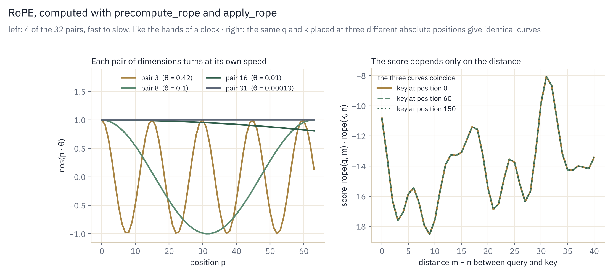
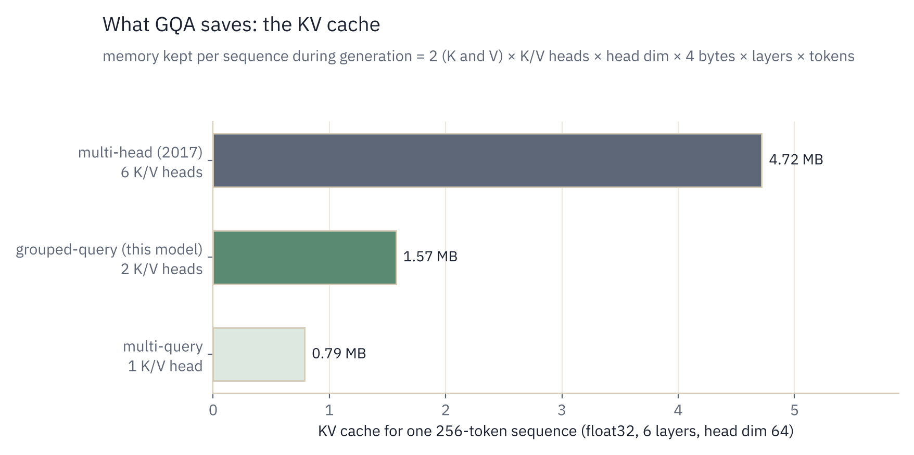
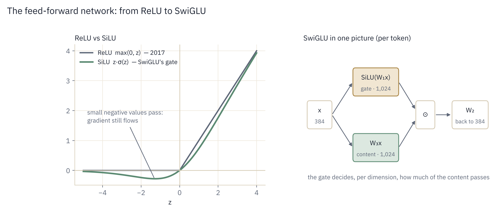
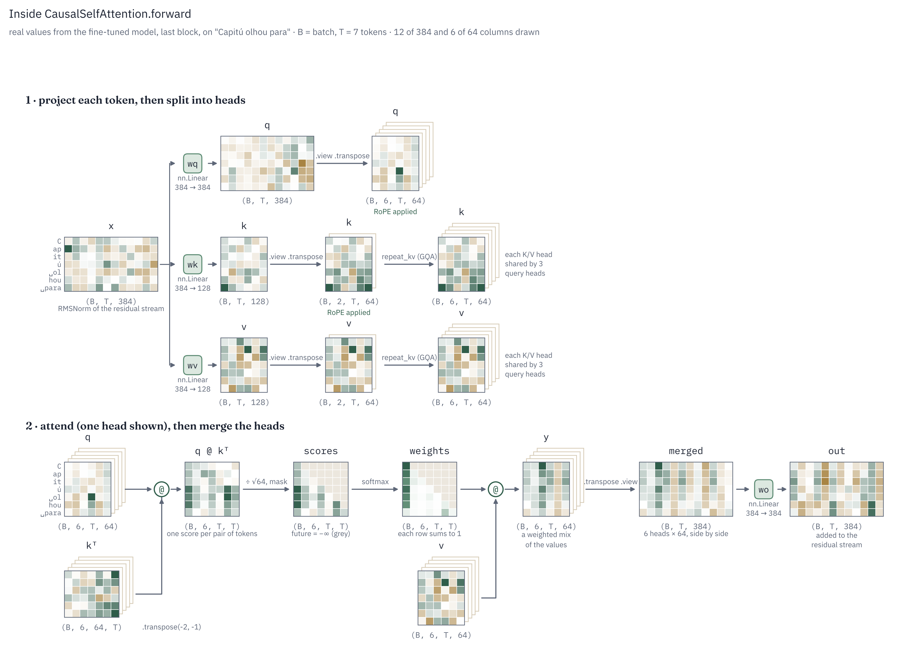
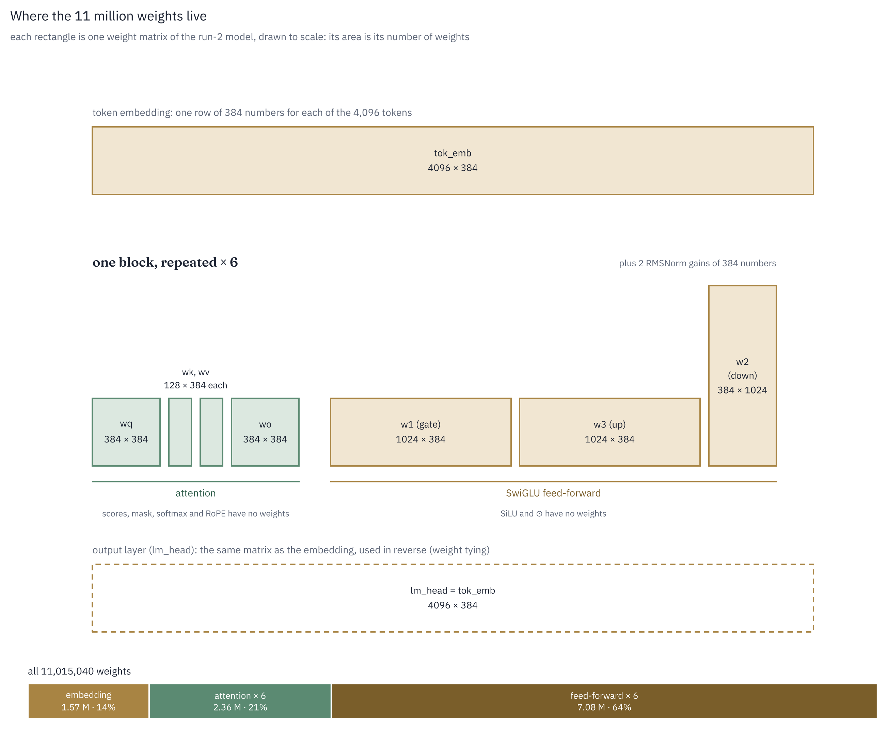

# Stage 3. The modern upgrades: RMSNorm, RoPE, GQA, SwiGLU

The attention formula from Stage 2 has not changed since 2017. Almost everything around it
has. This page covers the four replacements that open models such as Llama, Mistral and Qwen
made to the original Transformer, then the multi-head module that combines them.

| Piece | 2017 Transformer | This project |
|---|---|---|
| [Normalization](#1-rmsnorm) | LayerNorm, after each sublayer | RMSNorm, before each sublayer |
| [Positions](#2-rope-rotary-position-embeddings) | sinusoidal vectors added to the input | RoPE: rotate q and k |
| [Key/value heads](#3-gqa-grouped-query-attention) | one per query head | shared between query heads |
| [Feed-forward](#4-swiglu-the-gated-feed-forward) | ReLU MLP, 2 matrices | SwiGLU, 3 matrices |
| [Multi-head module](#5-the-multi-head-attention-module) | — | assembles all of the above |

---

## 1. RMSNorm

### Concept

Each layer adds its output to the **residual stream** (`x = x + layer(x)`, Stage 4). Over
many layers the values in that stream can drift very large or very small, which makes
training unstable. A normalization layer rescales each token's vector to a standard size
before it enters a sublayer, so every layer always receives inputs on the same scale.

### Formulas

LayerNorm (2017) centers and scales:

```math
\text{LayerNorm}(x) = \frac{x - \mu}{\sqrt{\sigma^2 + \varepsilon}} \odot \gamma + \beta
\qquad
\mu = \tfrac{1}{n}\textstyle\sum_i x_i,\;\; \sigma^2 = \tfrac{1}{n}\sum_i (x_i - \mu)^2
```

RMSNorm drops the centering and the bias:

```math
\text{RMSNorm}(x) = \frac{x}{\text{RMS}(x)} \odot g
\qquad
\text{RMS}(x) = \sqrt{\tfrac{1}{n}\textstyle\sum_i x_i^2 + \varepsilon}
```

- $n$: the vector length ($`d_{model}`$ = 384)
- $g$: a learned gain per dimension, initialized to 1
- $`\varepsilon = 10^{-6}`$: avoids division by zero

After normalization each vector has root-mean-square 1. Zhang and Sennrich found the
mean-subtraction contributes little to stability, so removing it saves computation in every
layer with no loss in quality.

### Worked example

$x = (3, -4)$: $`\text{RMS} = \sqrt{(9 + 16)/2} = 3.54`$, so $`x / \text{RMS} = (0.85, -1.13)`$.
The direction is kept; only the size changes.

### In the code: `RMSNorm.forward`

```python
return x * torch.rsqrt(x.to(torch.float32).pow(2).mean(dim=-1, keepdim=True)
                       + self.eps).to(x.dtype) * self.weight
```

- `pow(2).mean(dim=-1, keepdim=True)` computes the mean of squares over the last dimension,
  one value per token; `keepdim` keeps the shape `(…, 1)` so it broadcasts back over the vector.
- `torch.rsqrt(t)` is $`1/\sqrt{t}`$ in one operation.
- The mean of squares is computed in float32 (squares overflow first in low precision), then
  cast back to the input's type.
- `* self.weight` applies the learned gain $g$.

### Pre-norm

The 2017 Transformer normalized after each sublayer: `x = LayerNorm(x + F(x))`. Modern
models normalize before: `x = x + F(RMSNorm(x))`. The residual path then stays an
uninterrupted sum from input to output, which lets gradients flow straight through all layers.
Pre-norm Transformers train reliably and are far less sensitive to the learning-rate warmup that post-norm models depend on.

---

## 2. RoPE: Rotary Position Embeddings

### Concept

Attention by itself is blind to order: shuffle the tokens and every score $`q_i \cdot k_j`$ is
the same. Position has to be injected somehow.

The 2017 Transformer added a fixed sine-wave vector to each token's embedding. The model
then had to learn to extract relative distance from those absolute signals, and it generalized
poorly to sequences longer than those seen in training.

RoPE instead rotates the query and key vectors by an angle proportional to their position.
When two rotated vectors are compared, only the *difference* of their angles matters, so the
attention score depends on the distance between tokens, not their absolute positions. The
relationship between *Capitú* and a verb two words later means the same at the start of a
chapter or 200 tokens in.

### Formulas

Split each head vector ($d = 64$) into $d/2 = 32$ pairs of numbers. Pair $i$ is treated as a
point in 2D and rotated by angle $`p\,\theta_i`$ at position $p$:

```math
\begin{pmatrix} x'_1 \\ x'_2 \end{pmatrix}
=
\begin{pmatrix} \cos p\theta_i & -\sin p\theta_i \\ \sin p\theta_i & \cos p\theta_i \end{pmatrix}
\begin{pmatrix} x_1 \\ x_2 \end{pmatrix}
\qquad
\theta_i = \text{base}^{-2i/d},\;\; \text{base} = 10{,}000
```

Write $`R(\alpha)`$ for rotation by $`\alpha`$. Rotations satisfy $`R(\alpha)^\top = R(-\alpha)`$
and $`R(\alpha)R(\beta) = R(\alpha + \beta)`$, so for a query at position $m$ and a key at $n$:

```math
\big(R(m\theta)\,q\big)^\top \big(R(n\theta)\,k\big)
\;=\; q^\top R(-m\theta)\,R(n\theta)\,k
\;=\; q^\top R\big((n - m)\theta\big)\,k
```

The absolute positions $m$ and $n$ cancel; only $n - m$ remains.

### Why different frequencies

$`\theta_i`$ ranges from $1$ (pair 0: one radian per token) down to $10{,}000^{-62/64} \approx 1.3
\times 10^{-4}$ (pair 31). Fast pairs separate neighbouring tokens; slow pairs track coarse
distance across the whole window. Like the hands of a clock, together they can tell any
distance apart.

<p align="center">
  
</p>

### In the code: `precompute_rope` and `apply_rope`

```python
inv_freq = 1.0 / (theta ** (torch.arange(0, head_dim, 2).float() / head_dim))  # (d/2,)
positions = torch.arange(max_len).float()                                        # (T,)
angles = torch.outer(positions, inv_freq)                                        # (T, d/2)
return angles.cos(), angles.sin()
```

`torch.arange(0, head_dim, 2)` gives $`0, 2, 4, \dots, 62`$, i.e. $2i$. `torch.outer` builds the
table of $`p \cdot \theta_i`$ for every position and pair. It is computed once when the model is
created and stored as a buffer.

```python
x1, x2 = x.chunk(2, dim=-1)        # two halves, each (B, H, T, d/2)
out1 = x1 * cos - x2 * sin
out2 = x1 * sin + x2 * cos
return torch.cat([out1, out2], dim=-1).to(x.dtype)
```

This is the 2D rotation formula applied to all 32 pairs at once. The pairs are
$`(x_i, x_{i + d/2})`$, the first half with the second half. The RoFormer paper pairs adjacent
dimensions $`(x_{2i}, x_{2i+1})`$ instead; the two layouts are equivalent up to a fixed
reordering of dimensions, and the half-split version (used by GPT-NeoX and Hugging Face's
Llama) needs no interleaving. `cos` and `sin` have shape `(T, d/2)` and broadcast over batch
and heads. The final `.to(x.dtype)` matters: `cos`/`sin` are float32, so without it a bfloat16
input would come back as float32.

RoPE is applied to q and k only. Position should affect *who attends to whom*, not *what
information is passed along*, so `v` is never rotated.

---

## 3. GQA: Grouped-Query Attention

### Concept

Multi-head attention runs several attentions in parallel, each with its own projections,
so each head can specialize: one may track grammatical agreement, another names, another
punctuation. In 2017, each of the $H$ query heads had its own key and value head.

When a model generates text, it stores every past token's keys and values so they are not
recomputed. This store is the **KV cache**. At scale, that memory, not computation, limits how
many requests a GPU can serve at once. **GQA** lets several query heads share one key/value head:

```
query heads:  Q0  Q1  Q2 | Q3  Q4  Q5         H = 6
K/V heads:    ─── A ──── | ─── B ────         H_kv = 2
```

### Formulas

KV-cache size per token, per layer:

```math
\text{KV bytes} = 2 \times H_{kv} \times d \times \text{bytes per number}
```

Going from $`H_{kv} = 6`$ to $`H_{kv} = 2`$ makes the cache 3× smaller. GQA is the middle
ground between full multi-head ($`H_{kv} = H`$) and multi-query attention ($`H_{kv} = 1`$), and
recovers almost all of the quality of the former.

<p align="center">
  
</p>

### In the code: `repeat_kv`

```python
if n_rep == 1:
    return x
else:
    return torch.repeat_interleave(x, n_rep, dim=1)
```

`(B, 2, T, d)` becomes `(B, 6, T, d)` as `[A, A, A, B, B, B]`, so query heads 0–2 use key head
A and 3–5 use B. `torch.repeat` would give `[A, B, A, B, A, B]` and pair the wrong heads; the
test checks the order. With `n_rep == 1` the input is returned untouched (classic multi-head).

---

## 4. SwiGLU: the gated feed-forward

### Concept

Each block has two parts. Attention moves information *between* tokens. The
**feed-forward network** then processes each token *on its own*; much of a model's factual
and linguistic knowledge is stored in these weights. Every block alternates: gather context,
then process it.

### Formulas

2017 feed-forward:

```math
\text{FFN}(x) = W_2 \, \text{ReLU}(W_1 x)
\qquad
\text{ReLU}(z) = \max(0, z)
```

SwiGLU:

```math
\text{SwiGLU}(x) = W_2 \big( \text{SiLU}(W_1 x) \odot W_3 x \big)
\qquad
\text{SiLU}(z) = z \cdot \sigma(z) = \frac{z}{1 + e^{-z}}
```

| Matrix | Shape | Role |
|---|---|---|
| $`W_3`$ ("up") | $`d_{model} \to h`$ | the content: projects the token into a wider space |
| $`W_1`$ ("gate") | $`d_{model} \to h`$ | after SiLU, a per-dimension dial deciding how much content passes |
| $`W_2`$ ("down") | $`h \to d_{model}`$ | projects back so the result fits the residual stream |

$`\odot`$ is element-wise multiplication. Two changes compared to 2017:

1. The gate. One learned projection controls another, per token and per dimension,
   instead of the fixed rule "keep positives, drop negatives". This is the larger change
   ("GLU" stands for Gated Linear Unit).
2. SiLU instead of ReLU. It is smooth, and slightly negative for negative inputs, so gradients
   still flow where ReLU would output a flat zero.

| $z$ | −3 | −1 | 0 | 1 | 3 |
|---|---|---|---|---|---|
| ReLU | 0 | 0 | 0 | 1 | 3 |
| SiLU | −0.14 | −0.27 | 0 | 0.73 | 2.86 |

<p align="center">
  
</p>

### Hidden size

The 2017 FFN used $`h = 4\,d_{model}`$ with 2 matrices: $`8\,d_{model}^2`$ parameters. With 3
matrices, keeping the same budget gives $`3\,d_{model}\,h = 8\,d_{model}^2`$, so
$`h = \tfrac{8}{3} d_{model}`$. Here $`\tfrac{8}{3} \times 384 = 1{,}024`$, rounded to a multiple of 64
for hardware efficiency (already one).

### In the code: `SwiGLU.forward`

```python
return self.dropout(self.w2(F.silu(self.w1(x)) * self.w3(x)))
```

Read inside out: gate `F.silu(self.w1(x))`, content `self.w3(x)`, multiply, project down with
`self.w2`, then dropout. All three layers have `bias=False`, as in Llama, so the test can
close the gate: with $`W_3 = 0`$ the content is zero, and the output is exactly zero.

---

## 5. The multi-head attention module

### Concept

`CausalSelfAttention` turns a sequence of token vectors into q, k and v for every head, applies
RoPE and GQA, runs the Stage 2 attention, and merges the heads back.

```
x (B, T, 384)
 ├─ wq → (B, T, 384) → view (B, T, 6, 64) → transpose → q (B, 6, T, 64)
 ├─ wk → (B, T, 128) → view (B, T, 2, 64) → transpose → k (B, 2, T, 64)
 └─ wv → (B, T, 128) → view (B, T, 2, 64) → transpose → v (B, 2, T, 64)
                    │
          RoPE on q and k                          (§2)
          repeat_kv on k and v → 6 heads           (§3)
          causal attention                         (Stage 2)  → (B, 6, T, 64)
                    │
          transpose → (B, T, 6, 64) → view → (B, T, 384) → wo → output
```

### In the code: `CausalSelfAttention.forward`

The whole forward pass of the module, one tensor at a time, with its shape. The colours are real
values from the fine-tuned model (last block, on *"Capitú olhou para"*, "Capitú looked at"): green for positive,
brass for negative, grey for the masked future. Row 1 follows the three projections until
q, k and v each have 6 heads; row 2 follows one head through the scores, the softmax and the
mix of values, then glues the 6 heads back together.

<p align="center">
  
</p>

*Inspired by the step-by-step attention diagram of a class demo in IFT6758 (UdeM, Mila), redrawn for this model's code:
6 query heads, GQA with 2 key/value heads, and RoPE.*


```python
q = self.wq(x).view(B, T, self.n_head, self.head_dim).transpose(1, 2)
k = self.wk(x).view(B, T, self.n_kv_head, self.head_dim).transpose(1, 2)
v = self.wv(x).view(B, T, self.n_kv_head, self.head_dim).transpose(1, 2)
q = apply_rope(q, cos, sin)
k = apply_rope(k, cos, sin)
k, v = repeat_kv(k, self.n_rep), repeat_kv(v, self.n_rep)
if self.use_flash:
    y = F.scaled_dot_product_attention(q, k, v, is_causal=True,
                                       dropout_p=self.dropout if self.training else 0.0)
else:
    y = causal_attention(q, k, v, self.dropout, self.training)
y = y.transpose(1, 2).contiguous().view(B, T, -1)
return self.resid_dropout(self.wo(y))
```

| Step | Why |
|---|---|
| `view(B, T, H, d)` | splits the 384 numbers of each token into 6 heads × 64; no data moves |
| `transpose(1, 2)` | puts heads before tokens, so each head is an independent `(T, d)` matrix for attention |
| `use_flash` | same math through PyTorch's fused kernel; faster on GPUs, used by the `pc` preset |
| `transpose(1, 2).contiguous()` | `transpose` only changes how memory is indexed; `view` needs the data physically in order, so `contiguous()` copies it |
| `view(B, T, -1)` | concatenates the 6 heads back into one 384-vector per token |
| `wo` | mixes information across heads; its output is what the block adds to the residual stream |

### Parameter count per block (`mac` preset)

| Part | Shape | Parameters |
|---|---|---|
| `wq`, `wo` | 384 × 384, each | 294,912 |
| `wk`, `wv` | 384 × 128, each | 98,304 |
| SwiGLU `w1`, `w3`, `w2` | 384 × 1,024, each | 1,179,648 |
| 2 × RMSNorm | 384, each | 768 |
| **Block total** | | **1,573,632** |

6 blocks (9.44 M) + embedding 2,048 × 384 (0.79 M, shared with the output layer) + final norm
≈ 10.23 M parameters. Three quarters of each block is the feed-forward network.

Run 2's vocabulary is 4,096: the embedding becomes 4,096 × 384 = 1.57 M and the total
11.02 M. The blocks do not change: the vocabulary size only touches the embedding (and,
through weight tying, the output layer).

<p align="center">
  
</p>

*Each rectangle is one weight matrix, drawn to scale. wk and wv are thin because of GQA (2 key/value heads instead of 6), and the feed-forward matrices hold almost two thirds of all the weights.*

---

## How it is tested: `tests/test_stage3_modern.py`

| Test | What it proves |
|---|---|
| `test_3_1_rmsnorm` | matches the formula, and the output has RMS 1 |
| `test_3_2_rope_tables` | correct shapes; position 0 is no rotation; pair 0 turns 1 radian per position |
| `test_3_3_rope_preserves_norm` | rotation never changes vector length |
| `test_3_3_rope_depends_only_on_relative_position` | score at positions (5, 2) equals score at (40, 37), the defining property |
| `test_3_4_repeat_kv` | `[A, B]` becomes `[A, A, A, B, B, B]` |
| `test_3_5_swiglu` | right shape; closing the gate ($`W_3 = 0`$) lets nothing through |
| `test_3_6_multihead…` | the module's output is identical through your `causal_attention` and PyTorch's fused kernel |

## References

- Zhang, Sennrich (2019), *Root Mean Square Layer Normalization*. <https://arxiv.org/abs/1910.07467>
- Xiong et al. (2020), *On Layer Normalization in the Transformer Architecture* (pre-norm). <https://arxiv.org/abs/2002.04745>
- Su et al. (2021), *RoFormer: Enhanced Transformer with Rotary Position Embedding*. <https://arxiv.org/abs/2104.09864>
- Shazeer (2019), *Fast Transformer Decoding: One Write-Head is All You Need* (multi-query attention). <https://arxiv.org/abs/1911.02150>
- Ainslie et al. (2023), *GQA: Training Generalized Multi-Query Transformer Models from Multi-Head Checkpoints*. <https://arxiv.org/abs/2305.13245>
- Shazeer (2020), *GLU Variants Improve Transformer* (SwiGLU). <https://arxiv.org/abs/2002.05202>
- Touvron et al. (2023), *LLaMA: Open and Efficient Foundation Language Models*, the recipe combining all four. <https://arxiv.org/abs/2302.13971>
- Vaswani et al. (2017), *Attention Is All You Need*, §3.3 (FFN), §3.5 (positional encoding). <https://arxiv.org/abs/1706.03762>
