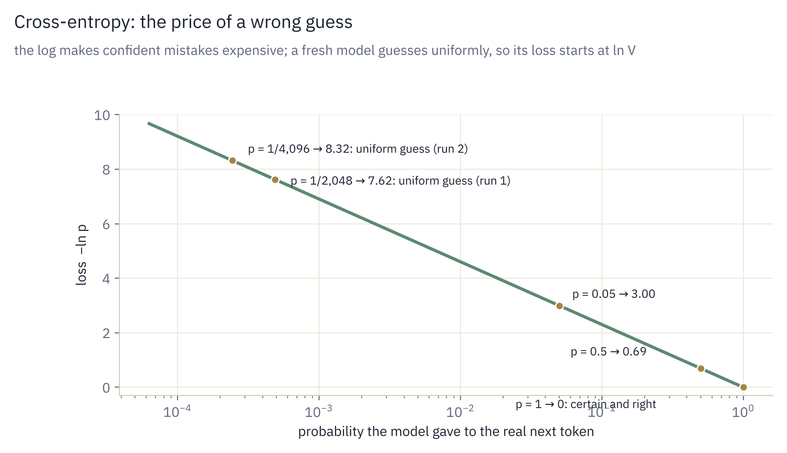
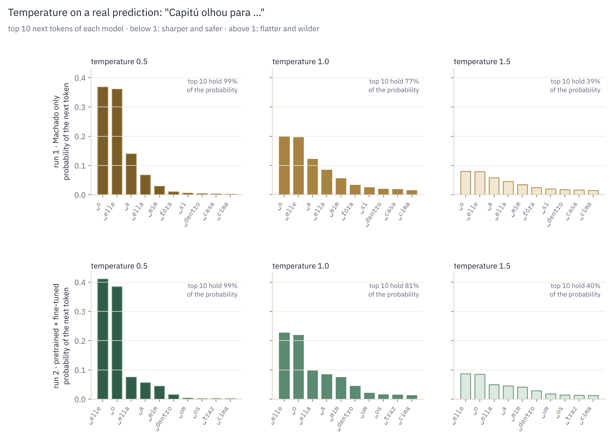

# Stage 4: Assembling the model

Stages 1–3 built the parts. This stage connects them into a model that reads token ids
and predicts the next token, measures how wrong it is, and writes text.

| TODO | What | Status |
|---|---|---|
| 4.1 | `Block.forward` — one Transformer layer | done |
| 4.2 | `TinyGPT.forward` — the full model and its loss | done |
| 4.3 | `TinyGPT.generate` — sampling text | done |

---

## 1. The block: residual connections and pre-norm

### Concept

A block has two sublayers: attention (gather context from earlier tokens) and the
feed-forward network (process each token on its own). Neither *replaces* the token's
vector. Each one reads a normalized copy and adds its result to it. The running vector
that every layer reads from and adds to is called the **residual stream**: the vertical
brass line in the [architecture diagram](README.md#the-whole-model-on-one-page).

### Formulas

```math
\begin{aligned}
x &\leftarrow x + \text{Attention}\big(\text{RMSNorm}_1(x)\big) \\
x &\leftarrow x + \text{SwiGLU}\big(\text{RMSNorm}_2(x)\big)
\end{aligned}
```

### Why add instead of replace

- A layer can learn to do nothing. If a sublayer outputs zeros, the block passes $x$
  through unchanged, so each layer only has to learn what to add, not rebuild everything.
- Gradients have a direct path. The derivative of $x + f(x)$ with respect to $x$ is
  $1 + f'(x)$. The "1" means the error signal from the loss reaches the first layer without
  being shrunk by every layer in between, which is what makes deep stacks trainable.
- The start is stable. `TinyGPT.__init__` initializes the last layer of each branch (`wo`,
  `w2`) with a smaller spread, $`0.02 / \sqrt{2L}`$, so at the start every block is close
  to pass-through and the stream does not grow with depth.

### In the code: `Block.forward`

```python
x = x + self.attn(self.norm1(x), cos, sin)
x = x + self.ffn(self.norm2(x))
return x
```

The normalization is applied to the input of each sublayer, never to `x` itself, so
the residual path stays an uninterrupted sum from the embedding to the output.

---

## 2. The full forward pass

### Concept

Token ids go in; for every position, the model outputs one score (a **logit**) per
vocabulary entry: how much it believes each token comes next.

```
idx (B, T)  ──tok_emb──►  (B, T, 384)  ──6 blocks──►  (B, T, 384)
            ──norm_f──►   (B, T, 384)  ──lm_head──►   logits (B, T, 2048)
```

There is no positional embedding added after `tok_emb`: position enters inside attention,
through RoPE (Stage 3).

### In the code: `TinyGPT.forward`

```python
x = self.tok_emb(idx)
x = self.drop(x)
for block in self.blocks:
    x = block(x, cos, sin)
x = self.norm_f(x)
logits = self.lm_head(x)
loss = None
if targets is not None:
    loss = F.cross_entropy(logits.reshape(-1, self.config.vocab_size), targets.reshape(-1))
return logits, loss
```

| Line | What it does |
|---|---|
| `self.tok_emb(idx)` | looks up a 384-number vector for each token id |
| `self.drop(x)` | dropout on the embeddings, during training only |
| `for block in self.blocks` | the 6 blocks, each reading and adding to the residual stream |
| `self.norm_f(x)` | one last RMSNorm, so the output layer gets inputs on a stable scale |
| `self.lm_head(x)` | 384 → 2,048 scores per position; its weight **is** the embedding matrix (weight tying) |
| `reshape(-1, V)` | flattens `(B, T, V)` into `(B·T, V)`: every position of every sequence is a separate prediction |

The last row is why Transformers train efficiently: with causal attention, one forward
pass trains $`B \times T`$ next-token predictions at once (32 × 256 = 8,192 per batch in
the `mac` preset), each position predicting its successor using only what came before.

### Weight tying

The embedding maps a token to a vector; the output layer maps a vector to token scores. Using the
same matrix for both (`self.lm_head.weight = self.tok_emb.weight`) saves 786,432
parameters (7.7% of the model) and tends to help small models: a token's input and output
representations are learned together.

---

## 3. The loss: cross-entropy

### Concept

Training needs one number that says how wrong the model is. For each position the model
gives a probability distribution over the 2,048 tokens. The loss looks only at the
probability it gave to the token that actually came next, and penalizes it for being
low.

### Formulas

Softmax turns the logits $z$ into probabilities:

```math
p_i = \frac{e^{z_i}}{\sum_{j=1}^{V} e^{z_j}}
```

Cross-entropy is the negative log of the probability of the correct token $y$, averaged
over all $`N = B \times T`$ positions:

```math
\mathcal{L} = -\frac{1}{N} \sum_{n=1}^{N} \log p_{y_n}
```

| Probability given to the right token | Loss for that position |
|---|---|
| 1.0 (certain and right) | 0 |
| 0.5 | 0.69 |
| 0.05 | 3.0 |
| 1 / 2,048 (pure guess, run 1) | 7.62 |
| 1 / 4,096 (pure guess, run 2) | 8.32 |
| 0.0001 (confident and wrong) | 9.2 |

The log makes confident mistakes very expensive, which pushes the model toward honest,
well-spread probabilities rather than overconfident guesses.

<p align="center">
  
</p>

### Why a fresh model starts at $`\ln V`$

An untrained model has no idea which token comes next, so it spreads its probability
evenly: $p = 1/V$ for every token. The loss is then

```math
\mathcal{L}_0 = -\log \frac{1}{V} = \ln V = \ln 2048 \approx 7.62
```

This is a sanity check for the first line of training output: a first loss near 7.6
means the model is wired correctly. A first loss of 15 or 0.5 means something is broken
before training even starts (`test_4_2_forward_shapes_and_initial_loss` checks this on a
small vocabulary of 97, where $`\ln 97 \approx 4.57`$).

### Perplexity

$`e^{\mathcal{L}}`$ is the **perplexity**: roughly, how many tokens the model is effectively
hesitating between at each step.

| Loss | Perplexity | Meaning |
|---|---|---|
| 7.62 | 2,048 | every token equally likely: no knowledge (run 1; 8.32 and 4,096 in run 2) |
| 5.0 | 148 | has learned common words and spelling |
| 3.0 | 20 | down to ~20 plausible continuations |
| 0 | 1 | always certain and right (on unseen text: impossible) |

`train.py` prints it as `ppl` at each evaluation.

---

## 4. Generating text

### Concept

Training uses every position at once. Writing has to go one token at a time, because each
new token depends on the ones just chosen. This is called **autoregressive** generation:

```
prompt ──► model ──► scores for the next token ──► pick one ──► append ──► repeat
```

Only the last position's scores matter at each step: they are the prediction for the
token that comes next. No loss is computed and no weights change, which is why `generate`
runs under `@torch.no_grad()`.

### Formulas

Temperature $`\tau`$ rescales the scores before softmax:

```math
p_i = \frac{e^{z_i / \tau}}{\sum_j e^{z_j / \tau}}
```

| $`\tau`$ | Effect |
|---|---|
| < 1 (e.g. 0.7) | sharper: the likely tokens become even likelier; safer, more repetitive |
| = 1 | the model's own probabilities |
| > 1 (e.g. 1.2) | flatter: rare tokens get a chance; more surprising, more mistakes |
| → 0 | always the single most likely token (greedy) |

Top-k keeps only the $k$ highest-scoring tokens and sets the rest to $`-\infty`$ (zero
probability) before sampling. It cuts off the long tail of very unlikely tokens, where most
nonsense comes from, without making the output deterministic.

Example with scores `[2.0, 1.0, 0.5, -1.0]`: at $`\tau = 1`$ the probabilities are
`[0.61, 0.22, 0.14, 0.03]`; at $`\tau = 0.5`$ they become `[0.84, 0.11, 0.04, 0.00]`.

<p align="center">
  
</p>

*Both models agree on the five most likely words (elle, o, ella, a, mim), in a slightly different order. At temperature 0.5 the two leading words take about three quarters of the probability; at 1.5 the top 10 hold only about 40 %, so a token from the long tail is picked most of the time.*

### What the prompt does

The prompt is the beginning of a text, and generation continues it. After the prompt
*"Capitú olhou para"* ("Capitú looked at"), the fine-tuned run-2 model gives these probabilities
for the next token: *elle* (him), *o* (him, or "the"), *ella* (her), *a* (her, or "the"), *mim* (me).

| Next token | Probability |
|---|---|
| `␣elle` | 0.226 |
| `␣o` | 0.219 |
| `␣ella` | 0.097 |
| `␣a` | 0.084 |
| `␣mim` | 0.074 |

One of them is drawn, appended, and the model runs again on the longer text. So the prompt
decides where the text starts and what is likely next, and every token the model writes
becomes part of the input for the following one.

This is a base model, not a chatbot. A question such as *"Quem é Capitú?"* ("Who is Capitú?") is continued as if it
were a line in a 19th-century book, not answered. Answering questions needs a further training
stage on question and answer examples (instruction tuning), which this project does not do.
To try prompts on both run-2 models side by side, see
[`notebooks/try_the_model.ipynb`](../notebooks/try_the_model.ipynb).

### In the code: `TinyGPT.generate`

```python
for _ in range(max_new_tokens):
    idx_cond = idx[:, -self.config.block_size:]
    logits, _ = self(idx_cond)
    logits = logits[:, -1, :] / temperature
    if top_k > 0:
        v, _ = torch.topk(logits, top_k)
        logits[logits < v[:, [-1]]] = float('-inf')
    probs = F.softmax(logits, dim=-1)
    nxt = torch.multinomial(probs, 1)
    idx = torch.cat([idx, nxt], dim=1)
```

| Line | What it does |
|---|---|
| `idx[:, -block_size:]` | the model can only see 256 tokens; for longer texts, keep the most recent ones |
| `logits[:, -1, :]` | the prediction made at the last position: `(B, T, V)` → `(B, V)` |
| `torch.topk(logits, top_k)` | the k largest scores per row; `v[:, [-1]]` is the k-th largest, the cut-off |
| `logits < cut-off → -inf` | everything below the top k gets probability 0 after softmax |
| `torch.multinomial(probs, 1)` | draws one token at random, following the probabilities: a 0.6 token is picked about 60% of the time |
| `torch.cat([idx, nxt], dim=1)` | appends it; the next loop sees one more token |

Sampling (rather than always taking the top token) is what makes outputs varied: the
same prompt gives a different continuation each run. `generate` also stops early if every
sequence produces `<|endoftext|>`.

### Cost

Each new token re-runs the whole model on the full context, so generating $n$ tokens costs
about $n$ forward passes. Real systems keep each layer's keys and values from previous steps
(the KV cache, the memory that GQA shrinks) so only the newest token is computed. This
project adds it in a later stage.

---

## How it is tested: `tests/test_stage4_model.py`

| Test | What it proves |
|---|---|
| `test_4_1_block_is_residual` | with `wo` and `w2` set to zero, the block returns its input unchanged |
| `test_4_2_forward_shapes_and_initial_loss` | logits have shape `(B, T, V)`; a fresh model's loss is within 0.5 of $`\ln V`$; no targets → no loss |
| `test_4_2_model_is_causal_end_to_end` | changing tokens 12+ leaves the predictions at positions 0–11 unchanged, through all layers |
| `test_4_2_can_memorize_one_batch` | 150 optimizer steps on one batch push the loss below 0.3; a model that cannot overfit one batch has a bug |
| `test_4_3_generate` | generating 40 tokens from a 3-token prompt works past `block_size` (the context is cropped), keeps the prompt intact and only produces valid token ids |

## 2017 vs. today

The 2017 Transformer already had residual connections and a shared embedding/output
matrix, but placed normalization *after* each residual addition (post-norm) and added
positional encodings to the embeddings. Today's decoder-only models keep the residual
stream exactly as is, move normalization before each sublayer, and move position into
attention.

## References

- He et al. (2015), *Deep Residual Learning for Image Recognition*. Residual connections. <https://arxiv.org/abs/1512.03385>
- Press, Wolf (2017), *Using the Output Embedding to Improve Language Models*. Weight tying. <https://arxiv.org/abs/1608.05859>
- Radford et al. (2019), *Language Models are Unsupervised Multitask Learners* (GPT-2). Scaled residual initialization. <https://cdn.openai.com/better-language-models/language_models_are_unsupervised_multitask_learners.pdf>
- Elhage et al. (2021), *A Mathematical Framework for Transformer Circuits*. The residual stream as a shared communication channel. <https://transformer-circuits.pub/2021/framework/index.html>
- Goodfellow, Bengio, Courville, *Deep Learning*, §5.5 (maximum likelihood and cross-entropy). <https://www.deeplearningbook.org>
