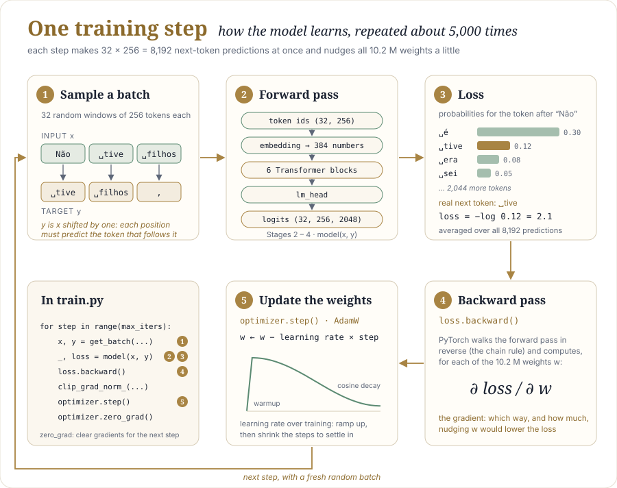
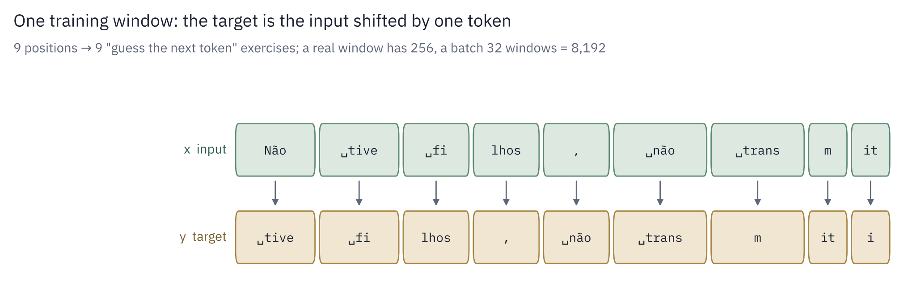
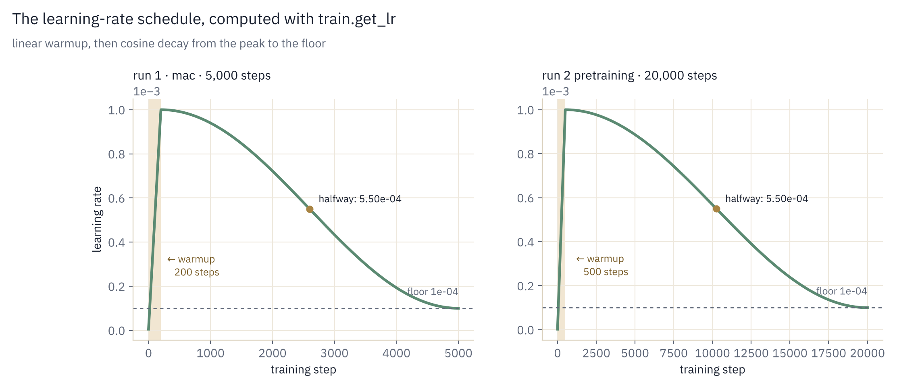

# Stage 5: The training loop

Stages 1–4 built a model whose 10.2 M weights (11.0 M in run 2) are random numbers. This stage writes the
loop that turns them into knowledge: steps ①, ⑤ and the whole cycle of the
[training-step diagram](the-big-picture.md#2-train-the-same-step-about-5000-times).

| TODO | What | Status |
|---|---|---|
| 5.1 | `get_batch` — sample training examples | done |
| 5.2 | `get_lr` — the learning-rate schedule | done |
| 5.3 | `train_step` — one optimizer step | done |

---

<p align="center">
  
</p>

## 1. Sampling a batch: `get_batch`

### Concept

Training never reads the corpus in order. Each step takes a **batch** of random windows
from `train.bin`, and for every window builds two sequences:

- `x`, the input: a window of `block_size` tokens
- `y`, the target: the same window shifted by one token

Read column by column, under every token of `x`, `y` holds the token that comes next.
One window of 256 tokens is therefore 256 "guess the next token" exercises, and one batch
of 32 windows is 8,192.

### Worked example

10 tokens of data (the last line of *Memórias Póstumas de Brás Cubas*), windows of
4 tokens, a batch of 2:

```
data = [ Não, tive, filhos, ",", não, transmiti, a, nenhuma, criatura, o ]
index:   0    1     2       3    4    5          6  7       8         9
```

First, pick random starting points. `torch.randint(10 − 4 − 1)` draws from 0 to 4 (the upper
bound 5 is excluded), so that both the window and the extra token needed for `y` fit inside
the data. Say `ix = [0, 4]`.

Then cut the input windows (4 tokens from each start) and stack them into a table:

```
x = [ [Não,  tive,       filhos, ","     ],    ← from position 0
      [não,  transmiti,  a,      nenhuma ] ]   ← from position 4
```

The targets are the same windows, starting one token later:

```
y = [ [tive,       filhos, ",",     não      ],
      [transmiti,  a,      nenhuma, criatura ] ]
```

Column by column, *tive* follows *Não*, *filhos* follows *tive*, *,* follows *filhos*, and so on.
Every position has its right answer, and the causal mask (Stage 2) guarantees the model cannot
just read it.

<p align="center">
  
</p>

### Formulas

For a start index $i$ and window length $T$:

```math
x = (t_i, \dots, t_{i+T-1})
\qquad
y = (t_{i+1}, \dots, t_{i+T})
\qquad
i \sim \text{Uniform}\{0, \dots, N - T - 2\}
```

where $N$ is the number of tokens in `train.bin`.

### In the code

```python
ix = torch.randint(len(data) - block_size - 1, (batch_size,))
x = torch.stack([torch.from_numpy(data[i:i + block_size].astype(np.int64)) for i in ix])
y = torch.stack([torch.from_numpy(data[i + 1:i + 1 + block_size].astype(np.int64)) for i in ix])
return x.to(device), y.to(device)
```

| Line | What it does |
|---|---|
| `torch.randint(len(data) - block_size - 1, …)` | `batch_size` random starting points; the upper bound keeps the window and `y`'s extra token inside the data |
| `data[i:i + block_size]` | the input window |
| `data[i + 1:i + 1 + block_size]` | the same window shifted by one: the targets |
| `.astype(np.int64)` | tokens are stored as `uint16` (2 bytes each, to save disk); PyTorch needs 64-bit integers for token ids |
| `torch.from_numpy` | turns the NumPy slice into a PyTorch tensor |
| `torch.stack([...])` | turns a list of `batch_size` vectors into one `(batch_size, block_size)` table |
| `.to(device)` | moves the batch to where the model lives (`mps` on Apple Silicon); PyTorch refuses to mix CPU and GPU tensors |

### Why random windows

The model sees a different mix of Machado at every step. It cannot learn the order of the
batches, only the patterns of the language. Over 5,000 steps × 8,192 positions ≈ 41 M
predictions, each training token is seen roughly 34 times, from many different starting
offsets.

### A lesson in scale

A first version of this function converted the whole dataset before slicing:

```python
data = torch.from_numpy(data.astype(np.int64))   # copies ALL tokens, every call
```

It returned exactly the same batches and passed the test, but copied the entire corpus on
every call to use 8,192 tokens of it:

| Corpus | Tokens | Time per batch |
|---|---|---|
| Machado | 1.2 M | 1.4 ms |
| All Portuguese books on Gutenberg (estimate) | ~30 M | 61 ms |

`train.bin` is opened as a **memory map** (`np.memmap`): only the slices actually read are
loaded from disk. Converting everything defeats that. Converting only the slices keeps the
cost constant however large the corpus gets. The difference is invisible on Machado alone
and becomes a bottleneck on a large corpus.

---

## 2. The learning-rate schedule: `get_lr`

### Concept

The **learning rate** is the size of the step each weight takes at every update. Too large
and training becomes unstable; too small and it barely moves. The best size also changes
during training, so `get_lr` returns a different value at each step:

```
lr
1e-3 ┤    ╭──╮
     │   ╱    ╲___
     │  ╱         ╲___
     │ ╱              ╲____
1e-4 ┤╱                    ╲______  min_lr
     └┬─────────────────────────┬──── step
      0   200                 5000
      warmup   cosine decay
```

- Warmup (steps 0–200): grow linearly from almost 0 to the peak. At step 0 the weights
  are random and the gradients erratic; large steps then push the model somewhere bad that
  is hard to recover from.
- Cosine decay (200–5,000): slide smoothly from the peak to the floor. Large steps early
  let the model explore; small steps at the end let it settle into a good spot instead of
  bouncing around it.

### Formulas

```math
\text{lr}(t) =
\begin{cases}
\text{lr}_{max} \cdot \dfrac{t + 1}{W} & t < W \\[8pt]
\text{lr}_{min} + \tfrac{1}{2}\big(1 + \cos(\pi \, p)\big)\,(\text{lr}_{max} - \text{lr}_{min}),
\quad p = \dfrac{t - W}{T - W} & W \le t < T \\[8pt]
\text{lr}_{min} & t \ge T
\end{cases}
```

with $W$ = warmup steps, $T$ = total steps. The factor $`\tfrac{1}{2}(1 + \cos \pi p)`$ goes
from 1 to 0 as $p$ goes from 0 to 1: flat near the peak, steepest in the middle, flat again
near the floor. That shape trains slightly better than a straight line down, and is what
GPT-3 and Llama used.

<p align="center">
  
</p>

### Worked example (`mac` preset: lr 1e-3, min 1e-4, warmup 200, 5,000 steps)

| Step | Learning rate | Phase |
|---|---|---|
| 0 | 0.000005 | warmup starts |
| 100 | 0.0005 | halfway through warmup |
| 199 | 0.001 | peak |
| 2,600 | 0.00055 | halfway down: exactly between peak and floor |
| 5,000 | 0.0001 | floor |

### In the code

```python
if it < cfg.warmup_iters:
    return cfg.lr * (it + 1) / cfg.warmup_iters
if it >= cfg.max_iters:
    return cfg.min_lr
progress = (it - cfg.warmup_iters) / (cfg.max_iters - cfg.warmup_iters)
return cfg.min_lr + 0.5 * (1 + math.cos(math.pi * progress)) * (cfg.lr - cfg.min_lr)
```

The three cases of the formula, in order. `main()` calls it every step and writes the value
into the optimizer: `for g in optimizer.param_groups: g["lr"] = lr`.

---

## 3. One optimizer step: `train_step`

### Concept

This is the loop in the [training diagram](the-big-picture.md#2-train-the-same-step-about-5000-times),
the five lines every deep-learning project has. Two ideas appear here for the first time:

Gradient accumulation. `loss.backward()` *adds* new gradients to the ones already stored.
So several small batches can be processed in a row, their gradients accumulated, and one
optimizer step taken at the end: the effect of a larger batch without needing the memory for
it. Dividing each loss by `grad_accum` turns the sum into an average. (The `mac` preset uses
`grad_accum = 1`; the test uses 2.)

Gradient clipping. Once in a while an unusual batch produces huge gradients. Before the
step, the gradient vector is scaled down if its norm exceeds `grad_clip` (1.0), so a single
bad batch cannot wreck the model.

Fine-tuning (run 2) uses this same function unchanged. The only differences are where the
weights start (`load_pretrained` copies them from the pretraining checkpoint), which data
`get_batch` reads, and the learning-rate schedule (1e-4 down to 1e-5 instead of 1e-3 down to
1e-4). See [Stage 6](06-training-runs.md).

### Formulas

The optimizer is AdamW. For each weight $w$ with gradient $g$:

```math
m \leftarrow \beta_1 m + (1 - \beta_1)\, g
\qquad
v \leftarrow \beta_2 v + (1 - \beta_2)\, g^2
```

```math
w \leftarrow w - \text{lr} \left( \frac{\hat m}{\sqrt{\hat v} + \varepsilon} + \lambda\, w \right)
```

- $m$ is a running average of the gradient (momentum). It smooths out noise between batches.
- $v$ is a running average of the squared gradient. Weights with consistently large gradients
  get smaller steps, so every weight moves at a sensible pace.
- $`\hat m, \hat v`$ are the same averages, corrected for starting at zero.
- $`\lambda`$ is the **weight decay** (0.1). It pulls every weight slightly toward zero at each step,
  which discourages memorization. It is applied only to matrices, never to RMSNorm gains
  (`configure_optimizer`).
- $`\beta_1 = 0.9`$, $`\beta_2 = 0.95`$. The second is lower than Adam's default 0.999, the
  usual choice for LLMs, so $v$ adapts faster.

### In the code

```python
loss = 0.0
for _ in range(tcfg.grad_accum):
    x, y = get_batch(data, mcfg.block_size, tcfg.batch_size, device)   # 1. sample a batch
    with ctx:
        _, batch_loss = model(x, y)                                    # 2-3. forward + loss
    (batch_loss / tcfg.grad_accum).backward()                          # 4. gradients
    loss += batch_loss.item()
torch.nn.utils.clip_grad_norm_(model.parameters(), tcfg.grad_clip)
optimizer.step()                                                       # 5. update
optimizer.zero_grad(set_to_none=True)
return loss / tcfg.grad_accum
```

| Line | What it does |
|---|---|
| `with ctx:` | on an NVIDIA GPU, runs the forward pass in bfloat16 (mixed precision); on the Mac, `ctx` does nothing |
| `.backward()` | PyTorch walks the forward pass in reverse (the chain rule) and fills `p.grad` for every weight |
| `.item()` | turns the one-element loss tensor into a Python float, for logging |
| `clip_grad_norm_` | rescales all gradients together if their total norm exceeds 1.0 |
| `optimizer.step()` | the AdamW update above, for every weight (10.2 M in run 1, 11.0 M in run 2) |
| `zero_grad(set_to_none=True)` | clears the gradients; without it the next step would add onto these. `set_to_none` frees the memory instead of filling it with zeros |

Around this function, `main()` adds what makes a run usable: the learning-rate schedule,
periodic evaluation on train and validation batches, saving the checkpoint with the best
validation loss, text samples, and the snapshot file for the "watch it learn" page.

---

## How it is tested: `tests/test_stage5_training.py`

| Test | What it proves |
|---|---|
| `test_5_1_get_batch_targets_are_shifted_inputs` | on `data = [0, 1, …, 999]`, shapes are `(8, 16)`, dtype is int64, and `y` equals `x` shifted by one everywhere |
| `test_5_2_lr_schedule` | tiny at step 0, peak at the end of warmup, exactly halfway between peak and floor at the midpoint, floor at the end, never increases after warmup |
| `test_5_3_train_step_reduces_loss` | on a perfectly predictable sequence, 60 steps with `grad_accum = 2` cut the loss to under 30% of its start; gradients are cleared afterwards |

## References

- Karpathy, *nanoGPT*. The memory-mapped `get_batch` pattern used here. <https://github.com/karpathy/nanoGPT>
- Loshchilov, Hutter (2019), *Decoupled Weight Decay Regularization* (AdamW). <https://arxiv.org/abs/1711.05101>
- Loshchilov, Hutter (2017), *SGDR: Stochastic Gradient Descent with Warm Restarts* (cosine schedule). <https://arxiv.org/abs/1608.03983>
- Kingma, Ba (2015), *Adam: A Method for Stochastic Optimization*. <https://arxiv.org/abs/1412.6980>
- NumPy `memmap` documentation. <https://numpy.org/doc/stable/reference/generated/numpy.memmap.html>
