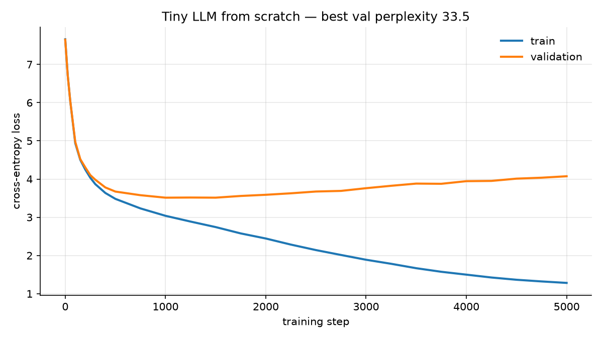
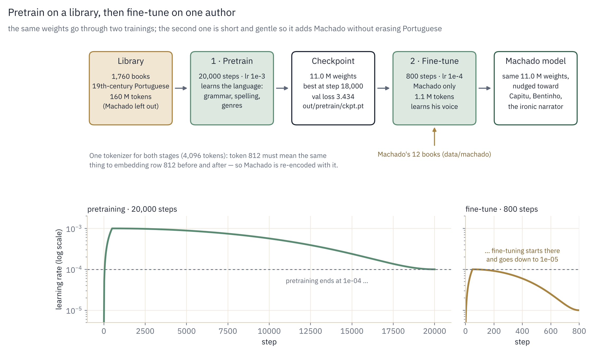
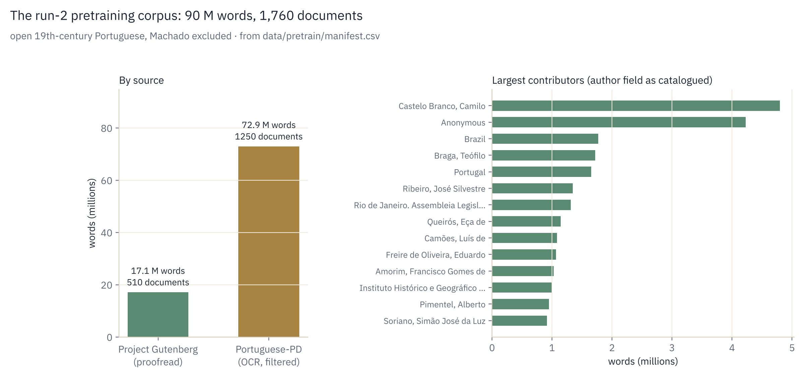
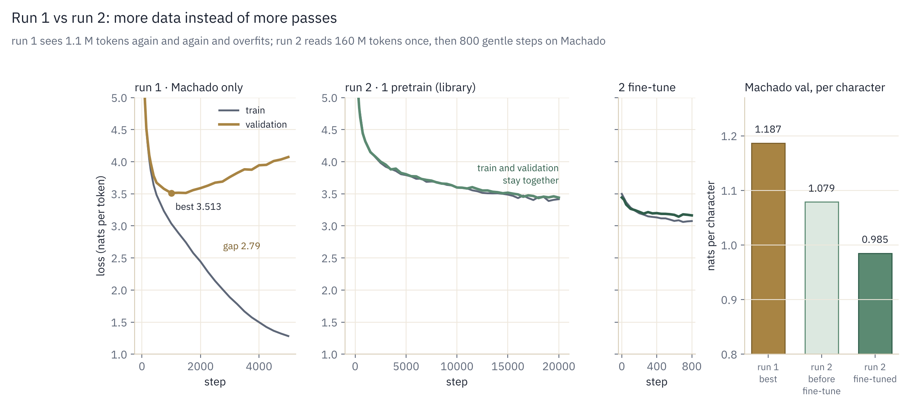

# Stage 6: Training runs and results

This page is the lab notebook: one section per run, with the setup, the numbers, what
the model wrote, and what was decided next.

| Run | Data | Model | Result | Status |
|---|---|---|---|---|
| [1](#run-1-machado-only) | Machado de Assis, 1.2 M tokens | 10.2 M params | best val loss 3.51 at step 1,000, then overfits | done |
| [2](#run-2-pretrain-on-open-19th-century-portuguese-fine-tune-on-machado) | open 19th-century Portuguese (160 M tokens, one pass) → fine-tune on Machado | 11.0 M | best val 3.143 on Machado (−17 % per character vs run 1), no overfitting in pretraining | done |

---

## Run 1: Machado only

### Setup

| | |
|---|---|
| Corpus | 12 books, 3.91 M characters, 1.19 M training tokens, 0.13 M validation |
| Model | `mac` preset: 6 layers, d_model 384, 6 heads / 2 KV heads, context 256; 10.23 M parameters |
| Training | 5,000 steps × 8,192 tokens = 41 M tokens seen ≈ 34 passes over the data |
| Optimizer | AdamW, lr 1e-3 → 1e-4 (200 warmup steps, cosine), weight decay 0.1, dropout 0.1 |
| Hardware | MacBook Pro (Apple Silicon, MPS), ~36 k tokens/s, 22 minutes |

### The loss curve

<p align="center">
  
</p>

| Step | Train loss | Val loss | Val perplexity | What is happening |
|---|---|---|---|---|
| 0 | 7.66 | 7.65 | 2,092 | uniform guess over 2,048 tokens: ln 2048 = 7.62, as expected |
| 100 | 4.94 | 4.97 | 144 | learned token frequencies |
| 500 | 3.48 | 3.67 | 39 | learned words and local grammar |
| 1,000 | 3.04 | **3.51** | 33.5 | best generalization; this checkpoint is kept |
| 2,000 | 2.44 | 3.59 | 36 | validation starts rising |
| 3,000 | 1.89 | 3.76 | 43 | |
| 5,000 | 1.28 | 4.07 | 59 | training perplexity 3.6 vs validation 59: memorized |

Three phases: fast learning to step ~500, slow improvement to step 1,000, then a widening
gap. The model's loss on text it trained on keeps dropping, while its loss on text it has never
seen gets worse. That is **overfitting**. `train.py`'s best-checkpoint rule (keep the weights
with the lowest validation loss) protects the result: the saved model is the step-1,000 one.

### Why it overfits

The Chinchilla rule of thumb is ~20 training tokens per parameter. This model has 10.2 M
parameters and 1.2 M distinct tokens, about 170× less than that. Seen 34 times each, the
same sentences become easier to memorize than the general patterns behind them.

### What the model wrote during training

Fixed prompt *"Nem por isso me zanguei."* ("That did not make me angry, though."), same random seed at every snapshot, so the
only thing that changes between lines is the weights (`out/snapshots.jsonl`):

| Step | Sample | What it shows |
|---|---|---|
| 0 | `� curenho pôde pôde pôde!» alM fosse fosseema Sophia Sophiabu�` | random tokens; `�` is half of a 2-byte character picked alone |
| 50 | `A, que, não se se o que não elle, a de em a para a verdade?` | only the most frequent words: it knows which words are common, not how they combine |
| 200 | `não é que o seu coração vamos a moça, mas então a verdade?` … `Cagavel`, `lendonça` | Portuguese word order; invented words where it still guesses pieces |
| 500 | `--Senhores, é um grande amigo, respondeu José Dias sorrindo.` | Machado's dialogue dashes; characters Capitú, José Dias (*Dom Casmurro*) |
| 1,000 | `--Confeição, redarguiu Camacho abriu mão de uma voz de ferro.` | 19th-century verbs (*redarguiu*, *apezar*); Palha, Camacho (*Quincas Borba*); clauses hold together |
| 2,000 | `D. CECILIA  Com effeito.  CAVALCANTE  Oh! não, não!  D. LEOCADIA` | switched to play format: reproducing the layout of one specific text (Machado's theatre) |
| 4,500 | `A baroneza passou a noite commigo… Luiz Alves… Guiomar` | the cast of *A Mão e a Luva*, together: retrieving a novel, not writing Portuguese |

Steps 50, 200, 500 and 1,000 show the model learning; steps 2,000 to 4,500 show it
memorizing.

### Decision

Keep run 1 as the "before" chapter. Fix the cause (data), not the symptom: pretrain on a
much larger open corpus of the same period, then fine-tune on Machado. Model code stays
unchanged so the two runs differ in one thing only.

---

## Run 2: Pretrain on open 19th-century Portuguese, fine-tune on Machado

> The step-by-step record of run 2, with every command, its output and timing, is in [Run 2: the log](06b-run2-log.md).

### The recipe

Production LLMs are built in the same two stages:

1. Pretraining on a large general corpus: the model learns the *language*
   (vocabulary, grammar, how sentences flow).
2. Fine-tuning on a small target corpus at a low learning rate: the model learns the
   *voice* (Machado's irony, rhythm, characters) without forgetting the language.

<p align="center">
  
</p>

*The fine-tune's learning rate starts at 1e-4, the level where pretraining ended, and goes 10× lower. Small steps adjust the weights toward Machado without overwriting what the library taught.*

### Data sources (all open, all publishable)

| Source | What | Size | License |
|---|---|---|---|
| Project Gutenberg, all Portuguese | 652 human-proofread texts in the catalogue, Brazil and Portugal, mostly 1850–1920 | 510 kept, 17.1 M words | public domain |
| [PleIAs/Portuguese-PD](https://huggingface.co/datasets/PleIAs/Portuguese-PD) | 7,840 books and periodicals published before 1884, from the Internet Archive and European national libraries; 672 M words | 1,250 kept, 72.9 M words | public domain, cleared for training and redistribution |

Portuguese-PD is OCR text (scanned books) and contains transcription errors, so only its
cleanest part is used, selected with a quality score (share of words that appear in the
Gutenberg vocabulary). Target: ~100 M tokens of pretraining text; the corpus as built gave 178 M.

**Machado is excluded from the pretraining corpus**, by author in both sources. Otherwise
the fine-tune would be re-reading text already seen, and the Machado validation split would
no longer measure generalization.

Rejected: Domínio Público (no bulk download, unclear terms); synthetic text generated by a
large LLM (the model would learn an imitation of Machado, and the project would stop being
from scratch).

### Plan (all done: results in [the log](06b-run2-log.md))

| Step | What | Command |
|---|---|---|
| 1 | Build the corpus: Gutenberg PT, then the cleanest Portuguese-PD documents until the whole corpus reaches 90 M words, with a manifest of sources. Done, 23 min | `python prepare_pretrain.py --source all --target_words 90e6` |
| 2 | Train a new tokenizer on the big corpus (vocabulary 4,096) and encode it. Done, 444 s + 0.7 min, 178 M tokens | `python prepare_tokens.py --data_dir data/pretrain --vocab_size 4096` |
| 3 | Encode Machado with the same tokenizer. Done, 1.25 M tokens | `python prepare_tokens.py --data_dir data/machado --corpus data/corpus.txt --tokenizer data/pretrain/tokenizer.json` |
| 4 | Pretrain: 20,000 steps ≈ 1 pass over the 160 M training tokens. Done, 82 min, best val 3.434 | `python train.py --preset mac-pretrain --max_iters 20000` |
| 5 | TODO 6.1, `load_pretrained` in `train.py`: load the checkpoint, check the architecture matches. Done, 28/28 tests pass | `pytest tests/test_stage6_finetune.py` |
| 6 | Fine-tune on Machado from the pretrained checkpoint: lr 1e-4, 800 steps, eval every 50. Done, 5 min, best val 3.143 | `python train.py --preset mac-finetune --init_from out/pretrain/ckpt.pt` |
| 7 | Compare run 1 vs run 2: loss curves, same prompts, same seed. Done | `sample.py`, `notebooks/try_the_model.ipynb` |
| 8 | Next: publish the curated corpus on Hugging Face with its manifest | — |

### How the OCR filter works

Portuguese-PD documents are scored by the share of their words (3+ letters) that appear in
the Gutenberg vocabulary (words seen at least 3 times in the proofread books). Clean text
scores ~0.95+; OCR-damaged text, other languages and tables of numbers score low. Documents
under 0.88 are dropped, as are documents with many non-letter characters, reference works
(dictionaries, grammars, catalogues) and anything by Machado. Very long titles (periodicals)
are capped at 150,000 words so no single one dominates. The thresholds are printed at the
end of the run with the score distribution, so they can be tuned.

### The corpus as built

| | |
|---|---|
| Gutenberg catalogue | 652 Portuguese-language texts |
| Gutenberg kept | 510 books, 17.1 M words; skipped: 82 too short, 39 duplicate titles, 14 Machado, 7 reference works |
| Dictionary for the OCR filter | 128,111 distinct words (seen ≥ 3 times in the Gutenberg text) |
| Portuguese-PD quality scores | median 0.82 · 10th percentile 0.60 · 90th percentile 0.92 |
| Portuguese-PD kept | 1,250 documents, 72.9 M words (score ≥ 0.88); rejected: 3,124 low quality, 194 OCR noise, 130 reference works; 149 long periodicals truncated |
| Total | **~1,760 documents, 90 M words, 545 MB**, built in 23 minutes |

<p align="center">
  
</p>

Gutenberg gave less than estimated (its Portuguese books are often short: poetry, plays,
essays), so Portuguese-PD supplies four fifths of the corpus. The filter kept about one
document in four, just above the median score.

Contamination check. Portuguese-PD covers books up to 1884, which includes Machado's early
novels (*Helena*, *Iaiá Garcia*, *Memórias Póstumas de Brás Cubas*). None are in the corpus:
no manifest title matches any of his works (the one "Helena" is Almeida Garrett's), and the
opening sentences of *Brás Cubas* and *Dom Casmurro* appear nowhere in `corpus.txt`. The
fine-tuning set and the Machado validation split stay unseen.

### Checkpoints: what is saved, and how fine-tuning starts from one

When a checkpoint is written: in the evaluation block of `train.py`, every time the
validation loss is measured.

```python
if losses["val"] < best_val:
    best_val = losses["val"]
    torch.save({"model": model.state_dict(), "model_config": mcfg.to_dict(),
                "iter": it, "val_loss": best_val},
               os.path.join(tcfg.out_dir, "ckpt.pt"))
```

The file is overwritten only when validation improves. In run 1 that last happened at step
1,000 (val 3.513); the next 4,000 steps never beat it, so `out/ckpt.pt` is the step-1,000
model. This is early stopping without stopping: training runs to the end, but only the best
weights are kept.

What is inside: `model.state_dict()` is a dictionary of every weight tensor, by name:
the embedding table, each block's `wq`, `wk`, `wv`, `wo`, `w1`, `w2`, `w3`, the RMSNorm gains.
About 40 tensors, 10.23 M numbers, 4 bytes each in float32, so ~40 MB. `model.py` describes the
*shape* of the network; the checkpoint holds the *values* training arrived at.

| In the checkpoint | Not in the checkpoint |
|---|---|
| all weights (`state_dict`) | AdamW's running averages $m$, $v$, so training can restart *from* these weights, not resume *exactly* where it stopped |
| `model_config`: the architecture | RoPE tables, rebuilt from the config (`persistent=False`) |
| the step and its validation loss | the tokenizer, a separate file; token 1456 means " janella" only in *that* vocabulary |

Loading for fine-tuning, `load_pretrained` (TODO 6.1):

```python
ckpt = torch.load(ckpt_path, map_location=device)
ckpt_config = ckpt["model_config"]
model_config = model.config.to_dict()
for key in ["vocab_size", "block_size", "n_layer", "n_head", "n_kv_head", "d_model"]:
    if ckpt_config[key] != model_config[key]:
        raise ValueError(f"Checkpoint architecture mismatch: {key} "
                         f"{ckpt_config[key]} != {model_config[key]}")
model.load_state_dict(ckpt["model"])
print(f"Loaded checkpoint {ckpt_path} from step {ckpt['iter']} with val loss {ckpt['val_loss']:.4f}")
return ckpt["iter"], ckpt["val_loss"]
```

| Line | Why |
|---|---|
| `map_location=device` | a checkpoint saved on the GPU (`mps`, `cuda`) can be loaded on any device |
| the architecture check | `load_state_dict` only works if every tensor has the same shape. Checking the six keys first turns an obscure shape error deep inside PyTorch into a clear message naming what differs, usually a different tokenizer (`vocab_size`) |
| dropout and `use_flash` not checked | they change how the model *runs*, not its weights, so the fine-tune can use a different dropout |
| `load_state_dict` | copies every saved tensor into the matching parameter of the fresh model |

`torch.load` defaults to `weights_only=True` in recent PyTorch: it only unpickles tensors,
numbers, strings and plain containers, which is exactly what this checkpoint holds, and it
refuses arbitrary objects. This is a safety measure, since unpickling can run code.

Tests (`tests/test_stage6_finetune.py`): the weights are copied exactly; a different dropout is
accepted; a different `vocab_size`, `n_layer` or `d_model` is rejected with the key named.

### Engineering notes

- The first version listed Gutenberg's Portuguese books through the Gutendex API, 32
  paginated requests, and timed out twice. It now downloads Gutenberg's own catalogue file
  (`pg_catalog.csv`, one row per ebook, ~15 MB) once, caches it for 30 days, and every
  download retries with a pause. That means fewer requests to a small volunteer service, and
  a reproducible list.
- Tokenizing 100 M+ tokens in pure Python: `prepare_tokens.py` trains BPE on a 10 M-character
  sample of paragraphs drawn from the whole corpus (not just the first books, which would bias
  the vocabulary toward a few authors), then encodes everything. Token ids are collected in
  `array("H")` (2 bytes each, the same uint16 written to disk) instead of a Python list
  (8-byte pointers per element): ~240 MB of memory instead of ~1 GB for 120 M tokens.
- The model's embedding table is indexed by token id, so pretraining and fine-tuning must use
  the same vocabulary. The Machado corpus is re-encoded with the pretraining tokenizer
  (`--tokenizer data/pretrain/tokenizer.json`); its run-1 tokenizer (2,048 tokens, Machado
  only) is not reused.
- Restarting is safe. The Gutenberg step rewrites `corpus.txt` and `manifest.csv` from
  scratch and reuses cached downloads, so an interrupted run resumes without duplicates. The
  PleIAs step appends; run on its own (`--source pleias`) it should be run once.

### Outcome

The prediction was that, at ~15 tokens per parameter seen once, validation loss would track
training loss for the whole run, and that the fine-tune would start to overfit within a few
hundred steps. The first held (gap within ±0.06 for 20,000 steps); the second only partly
(best at step 650, gap 0.09 at step 800).

| | Run 1 | Run 2 |
|---|---|---|
| Best val loss on Machado, per character | 1.187 | **0.985** (−17 %) |
| …before seeing any Machado | — | 1.079, already better than run 1 |

<p align="center">
  
</p>

Details, samples and why "Capitu" and "Capitú" give different results: [Run 2: the log](06b-run2-log.md).

---

## Stage 7. Next: modern upgrades

Run 2 completes the main story (built from scratch, overfits, fixed with open data, writes
like Machado). Future updates add one upgrade at a time, each with its own before/after
result: KV cache (7.1), QK-norm (7.2), DeepSeekMoE with
shared and fine-grained routed experts (7.3), and optionally Multi-head Latent Attention
(7.4). The last one completes a comparison inside this codebase: MHA (2017), then GQA (Llama,
Stage 3), then MLA (DeepSeek). See the [index](README.md#pages).

## References

- Hoffmann et al. (2022), *Training Compute-Optimal Large Language Models* (Chinchilla). <https://arxiv.org/abs/2203.15556>
- Howard, Ruder (2018), *Universal Language Model Fine-tuning for Text Classification* (pretrain, then fine-tune). <https://arxiv.org/abs/1801.06146>
- DeepSeek-AI (2024), *DeepSeek-V2: A Strong, Economical, and Efficient Mixture-of-Experts Language Model* (MLA and DeepSeekMoE). <https://arxiv.org/abs/2405.04434>
- PleIAs, *Portuguese-PD* dataset card. <https://huggingface.co/datasets/PleIAs/Portuguese-PD>
