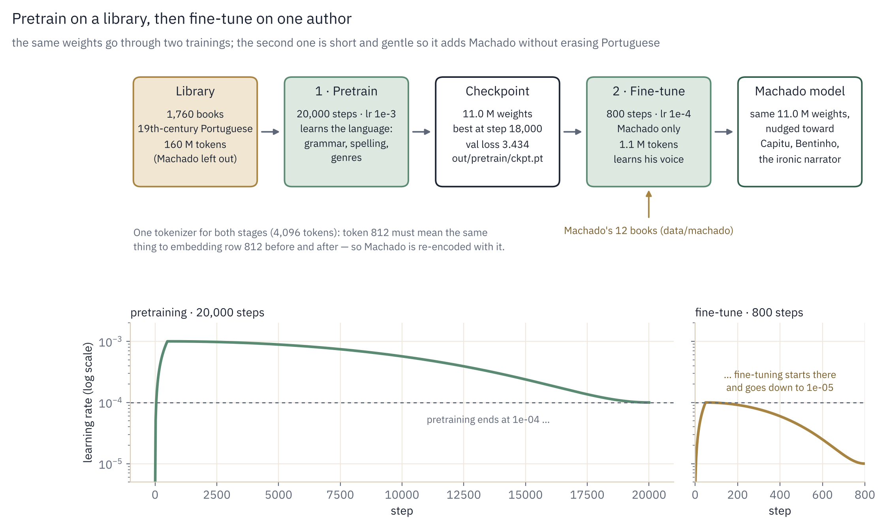
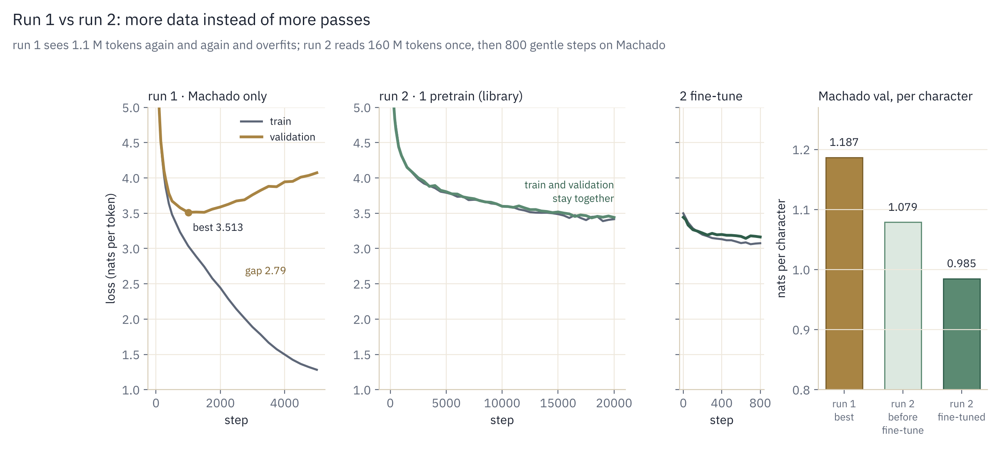

# Run 2: the log

A step-by-step record of run 2, written as it happened: each command exactly as typed, what
it produced, and how long it took. The *why* behind each step is in
[Stage 6: training runs and results](06-training-runs.md#run-2-pretrain-on-open-19th-century-portuguese-fine-tune-on-machado).

All commands run from the project folder on the Mac, with the environment active
(`source .venv/bin/activate`; the prompt starts with `(.venv)`). Each output is also saved with
`| tee showcase/<name>.txt`.

| # | Step | Status | Time |
|---|---|---|---|
| 1 | [Build the pretraining corpus](#1-build-the-pretraining-corpus) | done | 23 min |
| 2 | [Train the run-2 tokenizer and encode the corpus](#2-train-the-run-2-tokenizer-and-encode-the-corpus) | done | 8 min |
| 3 | [Encode Machado with the same tokenizer](#3-encode-machado-with-the-same-tokenizer) | done | seconds |
| 4 | [Pretrain](#4-pretrain) | done | 82 min |
| 5 | [Fine-tune on Machado](#5-fine-tune-on-machado) | done | 5 min |
| 6 | [Compare with run 1](#6-compare-with-run-1) | done | — |

---

## 1. Build the pretraining corpus

```bash
python prepare_pretrain.py --source all --target_words 90e6 2>&1 | tee showcase/prepare_pretrain.txt
```

Downloads every Portuguese book on Project Gutenberg, then the cleanest documents of the
PleIAs/Portuguese-PD dataset until the corpus reaches 90 M words. Writes
`data/pretrain/corpus.txt` and `data/pretrain/manifest.csv` (one line per source document).

Result (23 min):

```
Gutenberg catalogue: 652 Portuguese-language texts
Gutenberg: kept 510, skipped {'too short': 82, 'duplicate title': 39, 'reference work': 7, 'machado': 14}
after Gutenberg: 510 documents, 17.1M words
dictionary from Gutenberg text: 128,111 words
PleIAs quality scores: median 0.82, 10th pct 0.60, 90th pct 0.92
PleIAs: {'low quality': 3124, 'kept': 1250, 'ocr noise': 194, 'truncated': 149, 'reference work': 130}
```

In total, ~1,760 documents, 90 M words, 545 MB. Contamination check passed: no Machado text in
the corpus.

Problems along the way: the first two attempts timed out on the Gutendex API, so the script
now reads Gutenberg's own catalogue file instead. The log only appeared at the end because
Python buffers output sent through `tee`; fixed for later runs.

---

## 2. Train the run-2 tokenizer and encode the corpus

```bash
python prepare_tokens.py --data_dir data/pretrain --vocab_size 4096 2>&1 | tee showcase/tokenizer_pretrain.txt
```

Training means learning 3,839 BPE merges (4,096 tokens) on a 10 M-character sample of paragraphs
from the whole corpus. Encoding means converting all 545 MB of text into token ids with those
merges, and saving them as `train.bin` / `val.bin` (90/10 per document), stored as 2-byte integers.

Result: tokenizer trained in 444 s; encoding took 0.7 min (each distinct word is encoded once
and cached, so 178 M tokens go fast).

```
merge 1/3839:    (32, 100)  -> 256  ' d'       ← the same first merge as Machado's tokenizer
merge 101/3839:  (32, 283)  -> 356  ' in'
merge 3839/3839: (122, 324) -> 4094 'zil'

"vocab_size": 4096,
"train_tokens": 160143703,
"val_tokens": 17794646,
"chars_per_token": 3.06
```

```
How the tokenizer cuts text:
te| do| El|-|Do|rado| —| a| ful|g|ir| nas| are|ias| e| nos| cas|cal|hos|,| espada|n|ando| das| ent|ran|has| …
```

That is 178 M tokens, more than the ~120 M estimated: period spelling and OCR text average about
2 tokens per word. With a ~11 M-parameter model that is **~15 tokens per parameter**, close to the
Chinchilla rule of thumb (20), compared with 0.1 in run 1.

---

## 3. Encode Machado with the same tokenizer

```bash
python prepare_tokens.py --data_dir data/machado --corpus data/corpus.txt --tokenizer data/pretrain/tokenizer.json 2>&1 | tee showcase/tokenizer_machado_run2.txt
```

No training here (`--tokenizer` reuses the run-2 tokenizer); this only encodes Machado's
3.9 M characters into `data/machado/train.bin` and `val.bin`. This is necessary because the
pretrained model's embedding table is indexed by run-2 token ids: run 1's Machado files use a
different vocabulary (2,048 tokens), where the same id means a different piece of text.

Result (a few seconds):

```
reusing tokenizer data/pretrain/tokenizer.json (vocab_size=4096)
encoded 12/12 documents | 1.3M tokens
"train_tokens": 1125342,
"val_tokens": 125046,
"chars_per_token": 3.19
```

The same Machado sentence, cut by each tokenizer:

```
run 1 (2,048, trained on Machado):   | Co|ntei| a| an|ec|do|ta| aos| amigos| … | dom|in|go| vou| jantar| co
run 2 (4,096, trained on 90 M words): | Cont|ei| a| an|ec|do|ta| aos| amigos| … | domin|go| vou| j|antar| co
```

Run 2's tokenizer is slightly more compact on Machado overall (3.19 characters per token vs
2.96: 1.25 M tokens instead of 1.32 M) because it has twice as many tokens. But it was trained
on everyone *except* Machado, so a few words he uses often and the wider corpus doesn't, like
*jantar*, are no longer single tokens. A tokenizer reflects the text it was trained on.


---

## 4. Pretrain

```bash
caffeinate -i python train.py --preset mac-pretrain --max_iters 20000 | tee showcase/run2_pretrain.txt
```

`mac-pretrain` is the same 10 M-parameter architecture as run 1 (vocabulary now 4,096), dropout
0.05, lr from 1e-3 to 1e-4 with 500 warmup steps, evaluation every 500 steps. `--max_iters 20000`
means 20,000 × 8,192 ≈ 164 M tokens, about one pass over the training data. `caffeinate -i`
keeps the Mac awake. Writes `out/pretrain/ckpt.pt`, `log.csv`, `snapshots.jsonl`.

What to check: the first loss should be ≈ ln 4096 = 8.32, and validation loss should follow
training loss the whole way (no gap opening, unlike run 1).

Progress notes (during the run):

| Step | Train | Val | Gap | Note |
|---|---|---|---|---|
| 0 | 8.348 | 8.339 | — | ≈ ln 4096 = 8.32, as expected; 11.02 M parameters, 160 M training tokens, 1 pass |
| 1,000 | 4.314 | 4.318 | 0.00 | run 1 had already split by this step |
| 5,500 | 3.770 | 3.774 | 0.00 | |
| 6,000 | 3.733 | 3.771 | 0.04 | ~36 k tokens/s, ~85 min total |

At step 6,000 the terminal sample (prompt `"\n\n"`) came out as lines of `=====` and `�`.
That prompt, a blank line, mostly precedes headers, tables and separators in scanned books,
so it lands the model in the noisiest corner of the corpus. The fixed-prompt snapshots at the
same step are clean Portuguese:

> *Nem por isso me zanguei.* Saindo vendo a nossa porta do Snr. D. João, junto da villa, onde a
> capella de Santa Barbara, e outra na direita, do lado direito e o altar…

Checking the corpus for the cause found a few artefacts of the scanned (Portuguese-PD) part:

| Artefact | Occurrences | Share of the corpus |
|---|---|---|
| "Digitized by Google" lines (from Google Books scans) | ~15,000–20,000 | < 0.1 % of words |
| runs of `-----` / `......` (table rules, tables of contents) | ~7,500 | < 0.03 % of characters |
| runs of `=====` | 160 | negligible |
| U+FFFD (broken characters) | 0 | — |

Too small to justify restarting a run; noted for the published version of the corpus, which
will strip these lines in `prepare_pretrain.py`. The `�` in the sample are not in the data: the
model sampled half of a multi-byte character, as the untrained model did in Stage 4.

Result (82 min, 20,000 steps, ~36 k tokens/s): best validation loss **3.434** at step 18,000
(perplexity 31), final 3.440. No overfitting: the gap between train and validation stayed
within ±0.06 for the whole run, and validation was still going down slowly at the end. The
model ran out of steps, not out of things to learn.

| Step | Train | Val | Perplexity |
|---|---|---|---|
| 1,000 | 4.314 | 4.318 | 75 |
| 5,000 | 3.791 | 3.805 | 45 |
| 10,000 | 3.597 | 3.598 | 37 |
| 15,000 | 3.487 | 3.518 | 34 |
| 18,000 | 3.448 | 3.434 | 31 |
| 20,000 | 3.416 | 3.440 | 31 |

Compare run 1, where the gap opened after step 1,000 and validation ended 0.56 above its best.
Same architecture, same Mac; the difference is 160 M tokens seen once instead of 1.1 M tokens
seen ~37 times.

What the fixed-prompt snapshots show (`out/pretrain/snapshots.jsonl`, seed 42):

- At step 1,000: Portuguese-looking dialogue with em-dashes, old spelling (*elle*), broken grammar.
- At step 5,000 it has learned the *genres* of the corpus: play scripts (`MARQUEZ DE CAMPO`),
  government reports with dates and decrees.
- At step 20,000: grammatical 19th-century Portuguese. *"Nem por isso me zanguei."* continues as
  a rhymed poem (*"Sabeis quanto é bom, / Nem a ninguém, nem a gente…"*), and the other prompt
  produces an essay on Camões and poetry.

The prompt "Capitu" always continues as *"Capitual…"* (as in *capital*). Machado was
deliberately kept out of this corpus, so the pretrained model has never met Capitu; it only
knows the more common word that starts with the same tokens. Fine-tuning (step 5) should teach
it who she is.

The `--- iter …` lines are evaluations on the pretraining validation set (a mix of 19th-century
authors), so 3.434 is not yet comparable to run 1's 3.513 on Machado. Step 5 gives the number
that is.

---

## 5. Fine-tune on Machado

```bash
caffeinate -i python train.py --preset mac-finetune --init_from out/pretrain/ckpt.pt | tee showcase/run2_finetune.txt
```

<p align="center">
  
</p>

Loads the pretrained weights (`load_pretrained`, TODO 6.1) and continues on Machado only:
lr from 1e-4 to 1e-5, 800 steps, evaluation every 50. Writes `out/finetune/`.

What to check: the first validation loss should already be well below run 1's best (3.51,
though in run-2 tokens, see step 6); it will improve for a few hundred steps, then flatten, and
the best checkpoint is kept.

Result (5 min, 800 steps, ~5.8 passes over Machado): best validation loss **3.143** at step
650 (perplexity 23), final 3.164.

| Step | Train | Val | Note |
|---|---|---|---|
| 0 | 3.498 | 3.443 | the pretrained model, before any Machado: already better than run 1's best (see step 6) |
| 100 | 3.286 | 3.266 | most of the gain comes in the first 100 steps |
| 250 | 3.175 | 3.191 | |
| 650 | 3.087 | 3.143 | best, saved to `out/finetune/ckpt.pt` |
| 800 | 3.075 | 3.164 | gap 0.09: it is starting to memorise, but mildly, because the lr is small |

Why the "Capitu" prompt still failed: the fixed snapshot prompt still continued as
*"Capitude…"* after fine-tuning. The reason is in the data, not the model. The Machado edition
spells her name Capitú (346 times; "Capitu" without accent appears 3 times, inside
*Capitulo*). The two spellings tokenize differently (`C|ap|itu` vs `C|ap|it|ú`), so "Capitu"
points the model at *Capítulo* or *capital*, not at her. With the edition's spelling:

> pretrained: *Capitú.* / *Ai 1* / *Ai !* / *Thomaz (Piolho)* … (a play script; the name means nothing to it)
>
> fine-tuned: *Capitú achou um grande silencio, o mais baixo com a ponta de pedra. Sentou-se nos olhos
> com os olhos nella. Estacio inclinou-se novamente para ella. — Que é? perguntou ella sorrindo.*

This is narrative prose, with Machado's dialogue dashes and a character from *Helena* (Estacio).
More prompts, same seed, both models: `showcase/run2_prompts.txt`, or run them yourself in
[`notebooks/try_the_model.ipynb`](../notebooks/try_the_model.ipynb).

---

## 6. Compare with run 1

Same prompts, same seed, both models:

```bash
python sample.py --ckpt showcase/run1/ckpt.pt --tokenizer data/tokenizer.json --prompt "Nem por isso me zanguei." --seed 42
python sample.py --ckpt out/finetune/ckpt.pt --tokenizer data/pretrain/tokenizer.json --prompt "Nem por isso me zanguei." --seed 42
```

Losses are not directly comparable between the two runs: they use different tokenizers
(2,048 vs 4,096 tokens), so "nats per token" measures different units. The fair comparison is
per character: loss ÷ characters per token (2.96 for run 1, measured on Machado for run 2 at
step 3). The samples and the shape of the curves compare directly.

<p align="center">
  
</p>

Result: both validation sets are the last 10 % of each Machado book, so the comparison is on
the same text.

| | Run 1 (Machado only) | Run 2 (pretrain + fine-tune) |
|---|---|---|
| Parameters | 10.2 M | 11.0 M (larger vocabulary) |
| Tokenizer | 2,048, trained on Machado | 4,096, trained on the library |
| Characters per token on Machado | 2.96 | 3.19 |
| Best val loss (per token) | 3.513 at step 1,000 | 3.143 at fine-tune step 650 |
| Loss per character | 1.187 | **0.985 (−17 %)** |
| Overfitting | val rose 0.56 above its best; train–val gap 2.79 by step 5,000 | none in pretraining; gap 0.09 at the end of fine-tuning |
| Training time on the M-series Mac | 22 min | 82 + 5 min |

Even before seeing any Machado (fine-tune step 0, val 3.443, or 1.08 per character) the
pretrained model predicted Machado better than run 1, which trained on nothing else. Training
on his contemporaries taught it more about his text than training on his own books many times
over.
