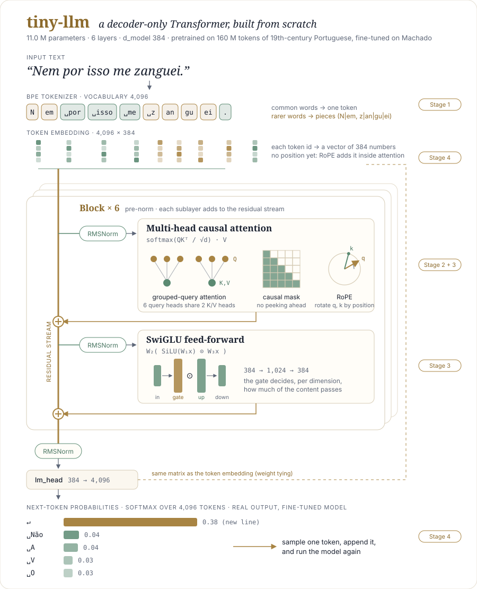

# The tiny-llm library

A step-by-step companion to the code, one page per stage, written as the project
advanced. Each page follows the same structure:

1. Concept: what problem this piece solves, in plain words
2. Formulas: the math, with every symbol defined
3. Worked example: the idea on numbers small enough to follow by hand
4. In the code: the actual implementation in this repo, line by line
5. How it is tested: what each test proves
6. 2017 vs. today: what changed since "Attention Is All You Need", and why
7. References: the papers and sources behind it

## The Portuguese in the examples

The model is trained on 19th-century Portuguese, so the examples are in Portuguese. Machado de
Assis (1839–1908) is Brazil's best-known novelist. Capitú is the heroine of his novel
*Dom Casmurro* (1899), told by her husband Bento, who suspects her of betraying him. The editions
used here keep the spelling of the time: *elle* and *ella* for today's *ele* and *ela*, *Capitú*
for today's *Capitu*.

| Portuguese | English | Where |
|---|---|---|
| *Capitú olhou para mim e disse que não* | Capitú looked at me and said no | attention heatmaps (02) |
| *Capitú olhou para…* | Capitú looked at… | prompt in 03, 04 and the big picture |
| *elle, o, ella, a, mim* | him, him/the, her, her/the, me | the model's top guesses for the next word |
| *Nem por isso me zanguei.* | That did not make me angry, though. | fixed prompt during training (06) |
| *Uma noite destas, vindo da cidade* | One of these nights, coming back from town | the first words of *Dom Casmurro* (01) |
| *não, ação, mão, emoção* | no, action, hand, emotion | the BPE worked example (01) |
| *Quem é Capitú?* | Who is Capitú? | the "not a chatbot" example (04) |

## Pages

| Stage | Page | Code | Status |
|---|---|---|---|
| 0 | [The data](00-data.md) | `prepare_data.py` | done |
| 1 | [Tokenization: byte-level BPE](01-tokenizer.md) | `tokenizer.py` | done |
| 2 | [Scaled dot-product attention](02-attention.md) | `model.py` · `causal_attention` | done |
| 3 | [The modern upgrades: RMSNorm, RoPE, GQA, SwiGLU](03-modern-upgrades.md) | `model.py` | done |
| 4 | [Assembling the model: residual stream, loss, sampling](04-assembling.md) | `model.py` · `Block`, `TinyGPT` | done |
| 5 | [The training loop: batches, learning rate, optimizer step](05-training-loop.md) | `train.py` | done |
| 6 | [Training runs and results](06-training-runs.md): run 1 (Machado only), run 2 (pretrain + fine-tune), checkpoints and fine-tuning | `train.py`, `prepare_pretrain.py` | done |
| 6b | [Run 2: the log](06b-run2-log.md): every command, output and timing, and the comparison with run 1 | | done |
| — | [Try the model](../notebooks/try_the_model.ipynb) (notebook): both run-2 models side by side | `notebooks/` | done |
| — | Next: future updates to this project, one modern upgrade at a time | | |
| 7.1 | KV cache | `model.py` · `generate` | — |
| 7.2 | QK-norm | `model.py` · `CausalSelfAttention` | — |
| 7.3 | DeepSeekMoE: shared + fine-grained routed experts | `model.py` · new `MoE` | — |
| 7.4 | *(optional)* Multi-head Latent Attention | `model.py` · `CausalSelfAttention` | — |

## The whole model on one page

  

How to read it, top to bottom:

1. The sentence is cut into tokens by the BPE tokenizer: common words stay whole, the rarer
   *zanguei* is split into pieces, and so is the capitalized *Nem* (these are the real cuts
   made by the run-2 tokenizer).
2. Each token id becomes a vector of 384 numbers through the embedding table.
3. Those vectors flow down the residual stream (the vertical brass line) through 6 blocks.
   In each block, two sublayers read a normalized copy of the stream and add their result
   back (⊕): attention first, to gather context from earlier tokens, then the feed-forward
   network, to process each token on its own.
4. A final RMSNorm and the output layer turn each vector into 4,096 scores, one per token in
   the vocabulary. The output layer reuses the embedding matrix (dashed line).
5. Softmax turns the scores into probabilities. Generation samples one token, appends it, and
   runs the model again. The probabilities shown are the real output of the fine-tuned
   run-2 model after *"Nem por isso me zanguei."*: after a sentence ends, the most likely
   next token by far is a line break (0.38), then the start of a new sentence.

The run-1 version of the diagram (vocabulary 2,048, 10.2 M parameters, Machado only) is kept
as [`img/architecture_run1.svg`](img/architecture_run1.svg). The architecture is identical;
only the vocabulary, and so the embedding table, changed.

## About the figures

Diagrams (`img/architecture.svg`, `img/training-step.svg`) are drawn for this project; the
tokens and probabilities in the architecture diagram come from the real tokenizer and model. Every plot
(`img/fig_*.png`, `img/attention_*.png`) is computed, not drawn: `scripts/make_figures.py` runs the
project's own code and data: `get_stats`/`merge` for the BPE example, `precompute_rope`/`apply_rope`
for RoPE, `get_lr` with the real presets, the actual predictions of the run-1 and run-2 models for temperature, the
corpus manifest for its composition. Change the code, run `python scripts/make_figures.py` (or the
notebook `notebooks/figures.ipynb`), and the figures follow. The idea of illustrating each step with small plots and heatmaps is inspired by
a class demo in the course IFT6758 (UdeM, Mila)
(after Karpathy's *Let's build GPT*); fonts are IBM Plex and Fraunces (SIL Open Font License).

## Notation used throughout

Worked examples in pages 01–05 use run 1's numbers (vocabulary 2,048, 10.23 M parameters),
because that is when those pages were written and checked. Run 2 changes only the vocabulary:
4,096 tokens, so the embedding table doubles and the model has 11.02 M parameters.

| Symbol | Meaning | Value in the `mac` preset |
|---|---|---|
| $B$ | batch size: sequences processed together | 32 |
| $T$ | sequence length (tokens in the window) | up to 256 |
| $`d_{model}`$ | width of the residual stream | 384 |
| $H$ | number of query heads | 6 |
| $`H_{kv}`$ | number of key/value heads | 2 |
| $d$ | dimension per head, $`d_{model} / H`$ | 64 |
| $V$ | vocabulary size | 2,048 (run 1) · 4,096 (run 2) |
| $L$ | number of layers (blocks) | 6 |

Shapes are written `(B, H, T, d)`, in the order PyTorch stores them.
