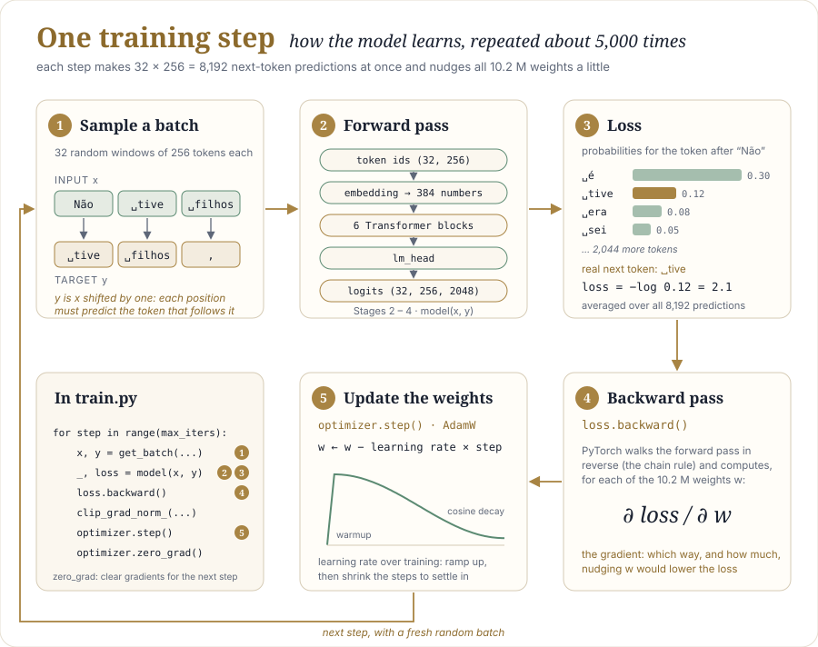
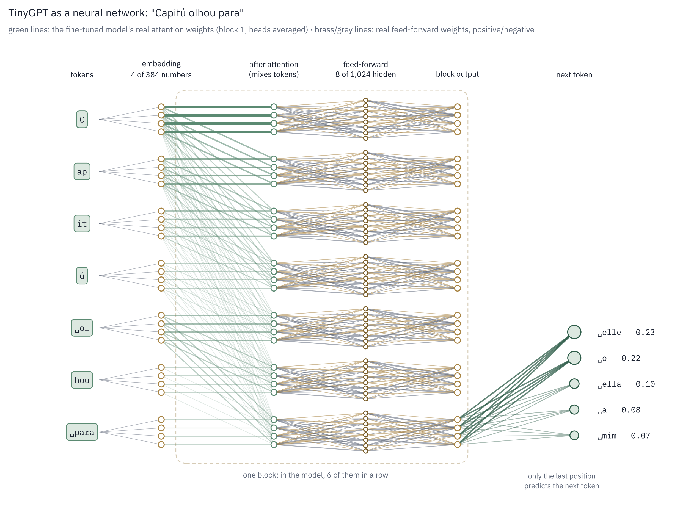

# The big picture

Read this page first, and come back to it whenever the details stop making sense
together.

## The one task

A language model does one thing: given some text, guess the next token. Grammar,
spelling, Machado's style: nobody programs any of it. It all emerges from repeating that
one task millions of times and correcting the model a little each time it is surprised.

## Three phases

### 1. Prepare the data: once

```
Machado's 12 books ──► prepare_data.py ──► corpus.txt (3.9 M characters)
                   ──► your BPE tokenizer ──► train.bin / val.bin (1.3 M token ids)
```

Run 2 adds a second corpus, the pretraining library (`prepare_pretrain.py`, 1,760 documents,
178 M token ids), and trains its own tokenizer on it. Machado is then encoded again with that
same tokenizer, because the model must see the same ids in both stages.

From this point the model never sees text, only token ids. The tokenizer is the bridge
in both directions: it turns text into ids for training, and ids back into text when the model writes.

### 2. Train: the same step, about 5,000 times

<p align="center">
  
</p>

| Step | What happens | Code | Built in |
|---|---|---|---|
| ① Sample a batch | 32 random windows of 256 tokens. The target `y` is the input `x` shifted by one, so every position has a "right answer": the token that follows it | `get_batch` | Stage 5 |
| ② Forward pass | ids → vectors → 6 blocks → one score per vocabulary token (2,048 in run 1, 4,096 in run 2) per position | `model(x, y)` | Stages 2–4 |
| ③ Loss | how surprised the model was by the real next tokens, averaged over 8,192 predictions | `F.cross_entropy` | Stage 4 |
| ④ Backward pass | PyTorch walks the forward pass in reverse and computes, for every one of the 10.2 M weights (11.0 M in run 2), which way to move it to lower the loss | `loss.backward()` | PyTorch |
| ⑤ Update | AdamW moves every weight a small step in that direction; the step size follows a schedule (warm up, then decay) | `optimizer.step()` | Stage 5 |

The probabilities in step ③ of the diagram are illustrative. The real numbers come from
your trained model in Stage 6.

That loop is the whole learning mechanism. Early on, the loss is ≈ ln V (the model guesses
uniformly: 7.62 for run 1's 2,048 tokens, 8.32 for run 2's 4,096). As the weights move, it first learns frequent words and
spelling, then grammar, then something of the author's rhythm.

Every few hundred steps, `train.py` also measures the loss on validation text the model
never trains on. When training loss keeps falling but validation loss stops, the model has
started memorizing instead of generalizing: overfitting.

Run 2 uses the same step twice: 20,000 times on the library (pretraining), then 800 times on
Machado starting from the pretrained weights, with a smaller learning rate (fine-tuning).
Nothing in the step changes; only the data, the starting weights and the learning rate do.

### 3. Generate: after training

```
prompt ──► model ──► probabilities for the next token ──► pick one ──► append ──► repeat
```

Only the forward pass is used; no loss, no weight changes. Temperature and top-k control
how adventurous the choice is.

## Where each piece fits

The whole model drawn as a classic neural network, on a real prompt. Each token becomes a
vector (4 of its 384 numbers are shown as circles); attention lets every token take
information from the tokens before it; the feed-forward network then processes each token on
its own; and the last position gives the probabilities of the next token.

<p align="center">
  
</p>

The attention lines use the fine-tuned model's real attention weights (first block, averaged
over its 6 heads): the first token, *C*, collects much of the attention, as noted in
[Stage 2](02-attention.md). The feed-forward lines show real weights from the first block,
brass for positive and grey for negative. The probabilities on the right are the model's
real output. The model repeats the middle part 6 times, with all 384 numbers per token and
1,024 hidden neurons in each feed-forward network.


| Piece | Job in one sentence | Stage |
|---|---|---|
| BPE tokenizer | turn text into the numbers the model works with, and back | 1 |
| Embedding | give each token id a learnable vector of 384 numbers | 4 |
| Attention | let each token gather information from the tokens before it | 2 |
| Causal mask | stop tokens from seeing the future, so predicting it is a real task | 2 |
| RoPE | tell attention how far apart two tokens are | 3 |
| GQA | share keys and values between heads to save memory | 3 |
| SwiGLU | process each token after it has gathered context | 3 |
| RMSNorm + residual stream | keep the 6 stacked layers stable enough to train | 3–4 |
| lm_head | turn each final vector into a score for every vocabulary token | 4 |
| Cross-entropy loss | the single number every weight is adjusted to reduce | 4 |
| AdamW + LR schedule | decide how far to move each weight at each step | 5 |
| Sampling | turn probabilities into actual text | 4 |

## The shapes, end to end (`mac` preset)

```
x          (32, 256)            token ids
embedding  (32, 256, 384)       one vector per token
6 blocks   (32, 256, 384)       same shape in and out: each block only adds to it
  inside attention: q (32, 6, 256, 64)  k, v (32, 2, 256, 64)  scores (32, 6, 256, 256)
logits     (32, 256, 2048)      one score per vocabulary token, at every position
loss       ()                   a single number
```

The shape never changes inside the stack of blocks, which is why blocks can be stacked
and why each one can add its result to the residual stream.

## Where to go next

- How the model is built: [the architecture diagram](README.md#the-whole-model-on-one-page)
- Each piece in depth: the [stage pages](README.md#pages)
